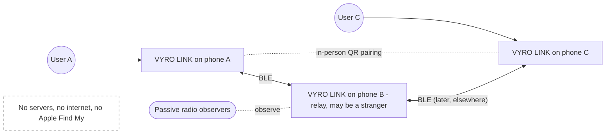
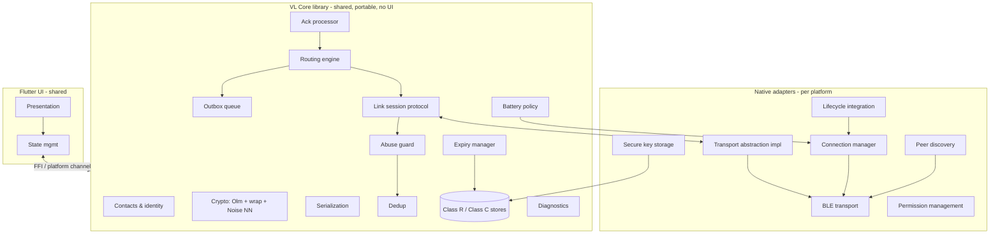
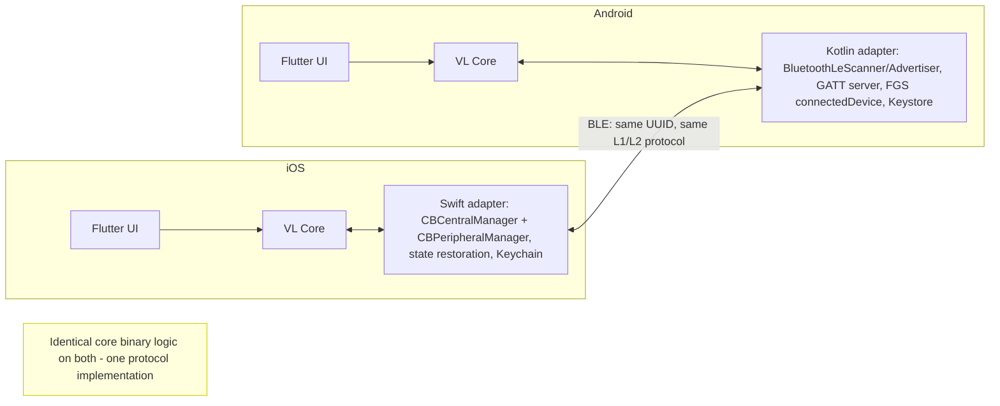
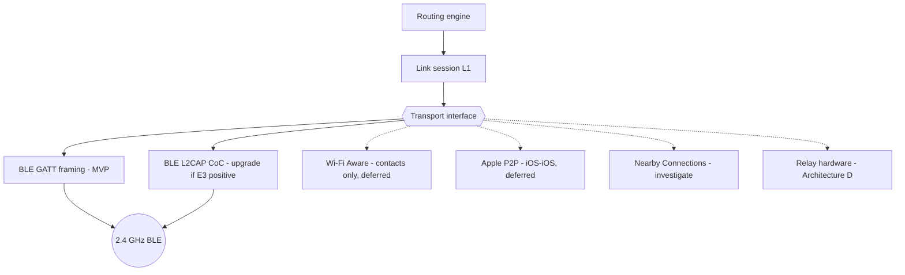
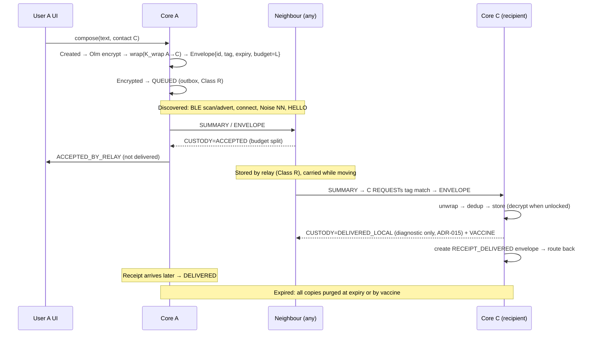
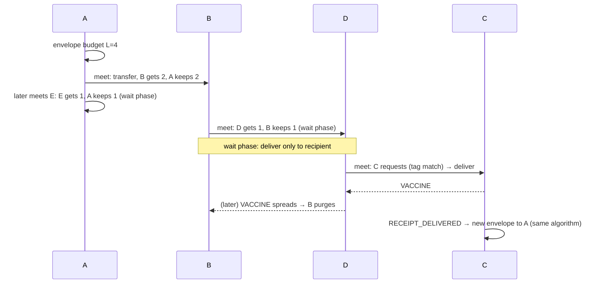
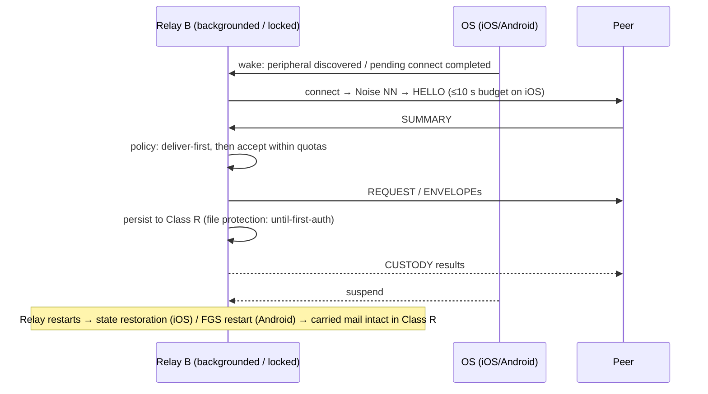
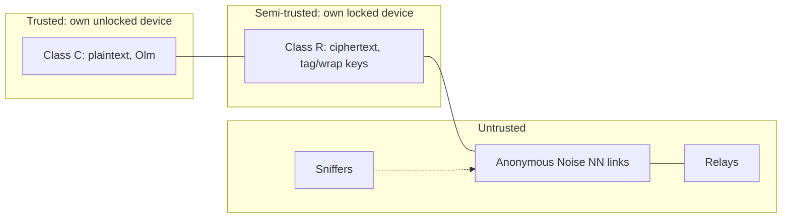

# Document 5 — System Architecture Specification

**Status:** proposed architecture, research only. Nothing here is implemented or proven. Components marked **[shared]** run identically on iOS and Android; **[iOS]**/**[Android]** need native platform code.

---

## 1. Candidate architectures compared

| | **A — BLE-first** | **B — Hybrid P2P** | **C — Transport-independent core + adapters** | **D — Phones + dedicated relay hardware** |
|---|---|---|---|---|
| Idea | BLE for discovery and data; app-level forwarding | BLE for discovery/rendezvous, Wi-Fi P2P for data | One routing/messaging protocol; pluggable transports (BLE first) | Phones talk BLE to always-on BLE/LoRa nodes that relay |
| Cross-platform | ✅ (BLE works iOS↔Android, Doc 4) | ⚠️ no common Wi-Fi P2P for strangers (iOS Wi-Fi Aware needs a per-device pairing UI; iPhone↔Android interop unproven) | ✅ via the BLE adapter | ✅ |
| Background on iPhone | best-effort | worse (pairing UI is interactive) | as A | phone only needs short sessions |
| Relays without user interaction | ✅ | ❌ for Wi-Fi among strangers | ✅ | ✅ (nodes) |
| Throughput | low (≈0.3–1.2 Mbps measured best case) | high | low now, upgradable | low (LoRa) / medium (BLE nodes) |
| Complexity | medium | high | medium + abstraction cost | high (hardware, firmware) |
| Meets brief (commodity phones only) | ✅ | partially | ✅ | ❌ (extra hardware) |
| **Verdict** | Correct transport choice… | Reject for MVP | **…implemented inside C's structure** | Fallback if E1/E2 fail (Doc 10 gate G1) |

**Decision:** **C-with-A** = a transport-independent core whose only MVP adapter is BLE (ADR-001, ADR-002). This costs little extra over pure A (one interface), and B or D can be added later without touching routing or crypto.

---

## 2. Component responsibilities

| # | Component | Responsibility | Where | Notes |
|---|---|---|---|---|
| 1 | Presentation layer | Screens: conversations, compose, contact pairing (QR show/scan), delivery states, relay settings, diagnostics | **[shared]** Flutter | No protocol logic |
| 2 | App state management | View models over core events | **[shared]** Flutter | — |
| 3 | Contact & identity management | Pairing cards, safety numbers, contact lifecycle, revocation | **[shared]** core | Uses crypto (11) |
| 4 | Peer discovery | Start/stop scan & advertise with the fixed UUID; RSSI gating; duty cycling | **[iOS]** Core Bluetooth / **[Android]** BluetoothLeScanner + Advertiser | Policy parameters come from core (21) |
| 5 | Transport abstraction | `Link` interface: open/close, send frame, receive frame, MTU, capabilities | **[shared]** interface; implementations native | Lets later adapters (Wi-Fi Aware, Nearby) plug in |
| 6 | BLE transport | GATT server + client, both roles; fragmentation; optional L2CAP CoC upgrade | **[iOS]**/**[Android]** | Pattern reference: bitchat iOS (public domain) |
| 7 | Platform P2P transports | Deferred (Wi-Fi Aware, Apple P2P, Nearby) | native | Post-MVP |
| 8 | Connection manager | Which peers to connect to, max links, backoff, wake-on-proximity pending connects (iOS) | native, driven by core policy | iOS cap TBD by E6 |
| 9 | Message serialization | Fixed binary header (L2), TLV link messages (L1) | **[shared]** core | No general-purpose parser on untrusted input |
| 10 | Cryptographic identity | Olm account, AK, signing | **[shared]** core (vodozemac) | Keys in secure storage (13) |
| 11 | End-to-end encryption | Pairwise wrap + Olm; Noise NN link | **[shared]** core | ADR-007/008 |
| 12 | Local encrypted storage | Class R + Class C SQLCipher stores | **[shared]** core + **native** key access | ADR-010 |
| 13 | Secure key storage | Keychain / Android Keystore wrappers for DB keys | **[iOS]**/**[Android]** | Different accessibility per class |
| 14 | Message queue (outbox) | Pending envelopes, retries, spray bookkeeping | **[shared]** core | Class R |
| 15 | Store-and-forward routing engine | Direct delivery + binary spray-and-wait; summary/request decisions | **[shared]** core | ADR-003 |
| 16 | Deduplication service | SeenSet by envelope_id; message_id at recipient | **[shared]** | Expiry-bounded |
| 17 | Acknowledgement processor | Custody vs delivered vs read; vaccines | **[shared]** | Doc 7 §7 |
| 18 | Expiry manager | GC of all expiry-bound stores; skipped-key purge | **[shared]** | Runs on every wake |
| 19 | Abuse prevention | Quotas, caps, rate limits, strict parsing | **[shared]** | Doc 6 §7 |
| 20 | Diagnostics | Local-only counters, link logs (opt-in export for testers) | **[shared]** + native log hooks | No identifiers persisted |
| 21 | Battery management | Duty-cycle policy from battery level, charging, relay mode, OS hints | core policy + native signals | Parameters from E5 |
| 22 | Permission management | Bluetooth / Nearby permissions, rationale UI, state monitoring | **[iOS]**/**[Android]** + Flutter UI | — |
| 23 | Platform lifecycle integration | iOS: background modes, state restoration, `willRestoreState`; Android: FGS `connectedDevice`, boot restart, `PendingIntent` scans | **[iOS]**/**[Android]** | Must run **without the Flutter engine** (ADR-004) |

---

## 3. Diagrams

### 3.1 System context



### 3.2 High-level components



### 3.3 Cross-platform architecture



### 3.4 Wireless transport architecture



### 3.5 Message lifecycle (sequence)



### 3.6 Multi-hop routing (A → B → D → C, binary spray-and-wait)



### 3.7 Contact pairing and identity verification

```mermaid
sequenceDiagram
  participant A as Phone A
  participant B as Phone B
  A->>A: show QR(PairingCard_A: keys, OTKs, nonce, sig)
  B->>A: scan QR_A (camera)
  B->>B: show QR(PairingCard_B)
  A->>B: scan QR_B
  A->>A: verify sig_B; K_pair = HKDF(X25519(AK_A, AK_B), salt=H(cards))
  B->>B: verify sig_A; same K_pair
  A->>A: safety number = f(fp_A, fp_B)
  B->>B: same safety number
  Note over A,B: Users optionally compare numbers aloud → "verified"
  A->>A: derive K_tag/K_wrap both directions; store (R) + contact (C)
```

### 3.8 End-to-end encryption

```mermaid
sequenceDiagram
  participant A as Sender core
  participant R as Relay
  participant C as Recipient core
  A->>A: Olm session (PreKey using C's OTK, or Normal)
  A->>A: inner = {type, message_id, ack_secret, sent_at, olm_msg}
  A->>A: body = ChaCha20-Poly1305(K_wrap A→C, nonce96, inner, AAD=header) [ADR-014]
  A->>R: [Noise NN link] envelope(header ‖ body)
  R->>R: validate header only; cannot decrypt
  R->>C: [Noise NN link] envelope
  C->>C: tag→contact; unwrap (Class R key, ok while locked)
  C->>C: on unlock: Olm decrypt (Class C)
```

### 3.9 Offline storage and forwarding



### 3.10 Delivery acknowledgement

```mermaid
sequenceDiagram
  participant C as Recipient
  participant R as Relays
  participant A as Sender
  C->>C: on unwrap: RECEIPT_DELIVERED{refs: message_id} wrapped with K_wrap C→A
  C->>R: receipt envelope (spray-and-wait like data)
  C->>R: VACCINE(ack_secret) → relays purge data copies
  R->>A: receipt envelope (eventually)
  A->>A: verify wrap (only C or A could create it) → DELIVERED
  alt no receipt before expiry
    A->>A: ACCEPTED_BY_RELAY → DELIVERY_UNKNOWN; QUEUED → EXPIRED
  end
```

### 3.11 Application lifecycle and background operation

```mermaid
stateDiagram-v2
  [*] --> Foreground
  Foreground --> Background: user leaves app
  Background --> Suspended: OS suspends
  Suspended --> Background: BLE event wake (~10 s iOS)
  Suspended --> Terminated_by_OS: memory pressure
  Terminated_by_OS --> Background: state restoration relaunch (pending BT event)
  Foreground --> ForceQuit: user swipes away (iOS) / force-stop (Android)
  Background --> ForceQuit
  ForceQuit --> Foreground: user reopens app (only exit)
  Background --> Reboot
  Reboot --> Background: iOS: after first unlock + pending request; Android: FGS restart
  note right of ForceQuit: No relaying, no receiving (iOS TN3115; Android stopped state)
  note right of Background: iOS: service-filtered scan, overflow advert; Android: FGS keeps full BLE
```

### 3.12 Threat model and trust boundaries

See Doc 6 §2 and §8 (two diagrams). They are summarised here:



---

## 4. Data flows (summary)

| Flow | Path | Persisted where |
|---|---|---|
| Send | UI → Core (Olm, wrap) → outbox (R) → link → neighbour | Message (C), Outbox envelope (R) |
| Relay | Link → abuse guard → dedup → carried store (R) → later link | CarriedEnvelope (R) |
| Receive (locked) | Link → tag match → unwrap → PendingInbound (R) → receipt + vaccine | R |
| Receive (unlock) | PendingInbound → Olm decrypt → Message (C) → UI | C |
| Ack | Receipt envelope → routing → sender → state update | C (message state) |

## 5. Routing design (MVP)

**Algorithm: direct delivery + binary spray-and-wait with expiry, hop limit and delivery vaccines.**

1. On every link session, exchange `SUMMARY` lists.
2. **Deliver first:** if the neighbour requests envelopes whose tag it owns (role DELIVER), send them. Deletion is not immediate; the envelope is kept until the vaccine or expiry, because the neighbour might be lying.
3. **Spray:** for each envelope with `copy_budget = n > 1` that the neighbour does not have and agrees to CARRY, send it with budget `floor(n/2)` and keep `ceil(n/2)`.
4. **Wait:** envelopes with budget 1 are offered only for DELIVER.
5. **Retry (sender only):** if there is no receipt by `t_retry` (proposal: 25 % of expiry) and the sender still holds budget 1, the sender may re-spray once with a fresh budget, keeping the same `envelope_id`. This mitigates black holes (T13).
6. **Purge** on vaccine, expiry, or quota eviction (earliest expiry first).

**Why this and not the alternatives:**

| Approach | Delivery probability | Latency | Storage | Duplicates | Energy | Privacy | Abuse resistance | Complexity | Phones w/ intermittent links | Decision |
|---|---|---|---|---|---|---|---|---|---|---|
| Direct delivery only | Low (needs A meets C) | Unbounded | Minimal | None | Lowest | Best | Best | Trivial | Poor | **Included** (special case) |
| Controlled flooding (live, TTL) | High in connected meshes | Low if connected | Low (no store) | Very high | High | Neutral | Poor (amplification; Bridgefy DoS [S28]) | Medium | Fails across partitions | Reject for data (would suit tiny control traffic only) |
| Epidemic routing (summary vectors) [S41] | Highest (given resources) | Lowest DTN latency | High (everyone stores everything) | Very high | High | Neutral | Poor | Medium | Good but resource-hungry | Reject (battery/storage, abuse) |
| Probabilistic forwarding (gossip p) | Medium | Medium | Medium | Medium | Medium | Neutral | Medium | Low | OK | Defer (tuning-sensitive) |
| **Spray-and-wait** [S40] | Good with modest copies in mobile crowds | Moderate | **Bounded by L** | **Bounded by L** | Moderate | **Needs no destination knowledge** | **Bounded amplification** | Low | Good | **Adopt** (bitchat independently chose the same, budget 4/cap 8 [S27]) |
| TTL/expiry-based | (modifier) | — | Bounded | — | — | — | Helps | Trivial | — | **Adopt as modifier** |
| Destination-aware (source routes / neighbour tables) | High in stable meshes | Low | Low | Low | Low | **Leaks topology** (bitchat §8) | Medium | Medium | Poor in DTN | Reject for MVP |
| Contact-history (PRoPHET [S39]) | Better than spray in structured mobility | Lower | Medium | Lower | Medium | **Needs stable destination IDs → conflicts with rotating tags** | Medium | High | Good | Defer to research (needs privacy design) |
| Hybrid (spray + live directed relay when a path exists) | Higher | Lower when connected | Bounded | Bounded | Medium | Some topology exposure | Medium | Medium–high | Good | Post-MVP candidate |

## 6. Platform-specific modules

| Module | iOS | Android |
|---|---|---|
| Discovery/transport | `CBCentralManager` + `CBPeripheralManager` with restore identifiers; service-filtered scan; GATT server characteristic; `CBL2CAPChannel` optional | `BluetoothLeScanner` (with `ScanFilter`), `BluetoothLeAdvertiser`, `BluetoothGattServer`; `createL2capChannel` optional |
| Background | `UIBackgroundModes`: `bluetooth-central`, `bluetooth-peripheral`; wake-on-proximity pending connects; `willRestoreState` | Foreground service type `connectedDevice` (opt-in Relay mode); `PendingIntent` scan for non-relay mode |
| Keys | Keychain (different accessibility per class) | Android Keystore (+ `setUnlockedDeviceRequired`) |
| Permissions | Bluetooth usage description; camera (QR) | `BLUETOOTH_SCAN` (neverForLocation), `BLUETOOTH_ADVERTISE`, `BLUETOOTH_CONNECT`, `POST_NOTIFICATIONS`, `FOREGROUND_SERVICE_CONNECTED_DEVICE`; camera |
| Engine-less operation | Core callable from Swift without Flutter | Core callable from Kotlin service without Flutter |

---

## 7. Architecture Decision Records

### ADR-001 — BLE is the primary transport for discovery and data
- **Context:** An iOS↔Android, no-infrastructure, no-pairing-UI transport is required.
- **Alternatives:** Wi-Fi Aware, Wi-Fi Direct, Apple P2P, Nearby Connections, BT Classic.
- **Evidence:** Doc 4 §1. Wi-Fi Aware needs DeviceDiscoveryUI/ASK pairing on iOS [S12, S13] and has reported interop failures [S16]. Wi-Fi Direct and RFCOMM are unavailable to iOS apps; Apple P2P is Apple-only [S14].
- **Advantages:** universal, background-capable on both platforms, no user pairing UI.
- **Disadvantages:** low throughput; asymmetric background visibility [S15].
- **Risks:** R-01, R-02, R-03.
- **Reversibility:** high (transport interface).
- **Open questions:** connection setup time; concurrent link limits (E1, E6).
- **Would change if:** BLE background exchange between a backgrounded iPhone and an FGS Android fails E1 → consider Architecture D.

### ADR-002 — Transport-independent core with native adapters (Architecture C, BLE-first)
- **Context:** Future transports are likely; two platforms must speak one protocol.
- **Alternatives:** pure A (protocol tangled with BLE code); separate per-platform protocol implementations (bitchat's approach: Swift + Kotlin).
- **Evidence:** bitchat maintains two codebases under different licences [S27, S27a]. That is a protocol-drift risk (inference).
- **Advantages:** one implementation of protocol/crypto/routing; desktop-testable; adapters stay thin.
- **Disadvantages:** FFI boundary.
- **Reversibility:** medium.
- **Would change if:** the FFI cost in background wakes is measurable (P3).

### ADR-003 — Routing: direct + binary spray-and-wait + expiry + vaccines
- See §5.
- **Evidence:** DTN literature [S40, S41, S39]; independent convergence by bitchat [S27].
- **Risks:** low delivery in sparse settings (R-04).
- **Reversibility:** high (routing-engine module; the envelope already carries a budget).
- **Open:** L, expiry and retry values → simulation E9.
- **Would change if:** E9 shows PRoPHET-class gains large enough to justify its privacy cost.

### ADR-004 — Core implementation language: portable library (provisional: Rust) + native adapters + Flutter UI
- **Status (2026-10-14): RESOLVED by ADR-013 in [Doc 18](18-development-blueprint.md) §5.** Rust core via UniFFI; native hosts own BLE and lifecycle; Flutter is UI only (Pigeon). Background relaying never needs the Flutter engine.
- **Context:**
  - Relaying must run when iOS relaunches the app in the background for ~10 s, or inside an Android FGS. Requiring a Flutter engine (Dart isolate) to boot inside that window is an **unvalidated risk** (D).
  - The E2E library chosen (vodozemac) is Rust.
  - A routing simulator needs the same code on a desktop.
- **Alternatives:**
  - (a) Dart core inside Flutter with a headless engine for background;
  - (b) Rust core via FFI;
  - (c) Kotlin Multiplatform core;
  - (d) two native apps (Swift + Kotlin), no Flutter.
- **Advantages of (b):** one core for iOS, Android and the desktop simulator; native-speed crypto; no Dart engine needed in the background.
- **Disadvantages:** four languages in the repo (Rust, Swift, Kotlin, Dart); build complexity.
- **Reversibility:** low after MVP, so this is **decided only after PoC P3** measures (i) cold background relaunch time with and without the Flutter engine, and (ii) FFI overhead.
- **Would change if:** a headless Flutter engine reliably completes a link session within the iOS wake budget → (a) is simpler.

### ADR-005 — Contacts-only messaging; in-person QR pairing; strangers relay
- **Context:** No server for key discovery; spam to users must be prevented.
- **Alternatives:** open messaging to anyone nearby (bitchat public chat); remote introductions.
- **Evidence:** Bridgefy impersonation/MITM history [S28, S29].
- **Advantages:** strong authentication; no stranger spam.
- **Disadvantages:** onboarding requires a meeting.
- **Reversibility:** additive (introductions later).

### ADR-006 — Compact custom envelope inspired by BPv7, not BPv7 itself
- **Context:** BLE payloads are small; relays must expose minimal metadata.
- **Alternatives:** BPv7 [S38] with BPSec.
- **Evidence:** BPv7 EIDs are routable names (conflicts with tag privacy); CBOR parsing on untrusted input is risk surface.
- **Advantages:** 62-byte fixed header; trivially bounds-checked.
- **Disadvantages:** no ecosystem interop.
- **Reversibility:** medium (versioned).

### ADR-007 — E2E: Olm (vodozemac) inside a pairwise AEAD wrap
- **Context:** Ciphertext sits on strangers' phones for hours to days, so forward secrecy matters.
- **Alternatives:**
  - libsignal (AGPL-3.0 [S46]);
  - Noise X one-way seals (no FS, replayable [S43]; bitchat's choice [S27]);
  - custom ratchet (rejected: inventing crypto);
  - libsodium sealed boxes (no FS).
- **Evidence:** vodozemac is Apache-2.0 and was audited by Least Authority in 2022 (10 issues, 8 suggestions reported [S45]); the Double Ratchet supports out-of-order messages with skipped keys [S42].
- **Disadvantages:** Olm (not PQ); OTK exhaustion falls back to weaker first-message FS; requires Rust FFI; the existing Dart wrapper is AGPL.
- **Risks:** R-12.
- **Reversibility:** medium (inner version).
- **Would change if:** the product licence becomes AGPL-compatible (then libsignal/PQXDH), or a permissive audited PQ ratchet matures.

### ADR-008 — Anonymous Noise NN link encryption; no BLE bonding
- **Context:** Hide tags and IDs from passive sniffers without identifying relays.
- **Alternatives:** BLE pairing/bonding (user prompts; leaks identity across sessions); Noise XX with static keys (bitchat: identity exposure).
- **Advantages:** no prompts; unlinkable.
- **Disadvantages:** active MITM possible on a link (gains only relay-level view).
- **Reversibility:** high.

### ADR-009 — Pairwise, epoch-rotating recipient tags (E = 6 h initial)
- **Context:** Addressing without identity.
- **Alternatives:** recipient-key HMAC (bitchat; computable by all of the recipient's contacts); per-message slots.
- **Disadvantages:** the recipient computes a table; within-epoch grouping is visible.
- **Open:** E and slots (S-R1).

### ADR-010 — Two-class local storage (Class R / Class C)
- **Context:** Must relay and receive while locked, but protect plaintext.
- **Evidence:** Apple data-protection classes [S63]; TN3115 relaunch after first unlock [S11].
- **Advantages:** locked-device relaying with plaintext under the strongest class.
- **Disadvantages:** pairwise keys exposed to forensic extraction after first unlock (T11).

### ADR-011 — Android Relay mode = opt-in FGS `connectedDevice`; iOS = best-effort + user education
- **Context:** Doc 4 §3–4.
- **Risks:** Play policy (R-07); OEM killing (R-08).
- **Would change if:** Play rejects → fall back to `PendingIntent` scans plus foreground sessions only.

### ADR-012 — No internet path in MVP
- **Context:** Infrastructure-free goal; avoid scope and metadata creep.
- **Alternatives:** Nostr bridge (bitchat), own relay server.
- **Reversibility:** high (it would be another transport adapter).
- **Would change if:** field tests show partitions rarely heal without the internet (E9/E12).
