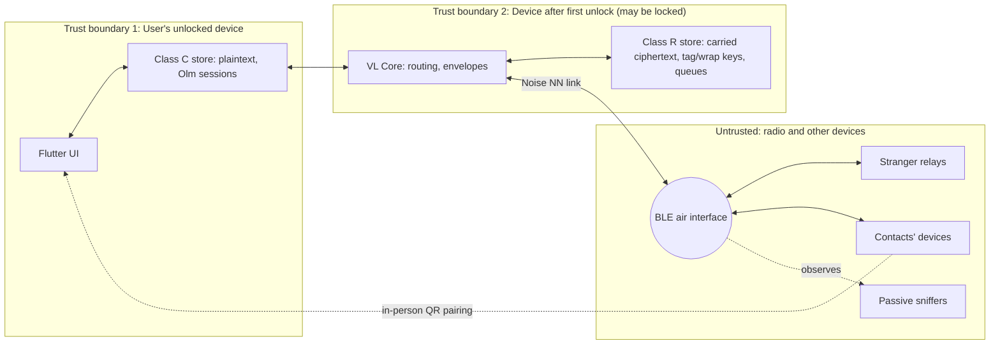
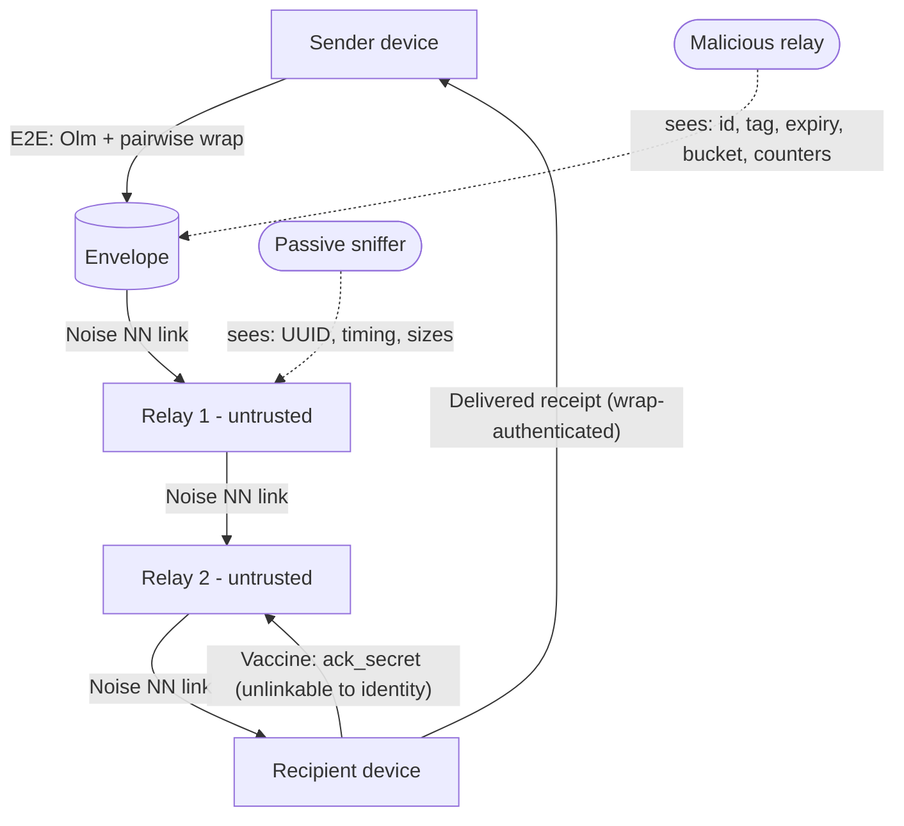

# Document 6 — Security and Privacy Specification

**Specification level only:** no new primitives are invented and no code is written. Every primitive below is a standard one, used through an audited library where possible. **An independent cryptographic and security review is mandatory before any public release** (roadmap phase P9, Doc 11).

> **Design summary.**
> - **Identities** are exchanged **in person by mutual QR scan**. There is no server, so there is no other trustworthy key distribution.
> - **Content** uses **Olm (Double Ratchet)** via the audited Apache-2.0 library *vodozemac*. One-time prekeys are exchanged at pairing, so stored ciphertext gets **forward secrecy**.
> - **Outer layer:** every envelope is additionally wrapped with a **pairwise symmetric key** and addressed by a **pairwise, epoch-rotating tag** that only the sender and recipient can compute.
> - **Relays** see a random envelope ID, the tag, an expiry, a size bucket and routing counters — never sender identity or content.
> - **Neighbour links** are encrypted with an **anonymous Noise NN** handshake, so passive radio observers learn nothing beyond the existence of a VYRO LINK device.
> - **Abuse** is bounded by expiry, copy budgets, size limits and quotas. Sybil resistance is weak by construction, and this is stated as a residual risk.

---

## 1. Assets

| Asset | Where it lives | Sensitivity |
|---|---|---|
| Message plaintext | Sender/recipient devices only | High |
| Social graph (who talks to whom) | Contact store; inferable from traffic | High |
| Identity private keys | Devices (secure storage) | Critical |
| Pairwise secrets (tag/wrap keys) | Both contacts' devices | High |
| Location/presence history | Inferable from radio activity | High |
| Relay storage and battery | Every participating device | Medium (availability) |
| Delivery status | Sender UI | Medium (integrity of user expectations) |

## 2. Trust boundaries



Contacts are **semi-trusted**. They are authenticated, and they can read messages addressed to them and recognise their own pairwise tags; they are not trusted with anything else. Relays are **untrusted**.

## 3. Identity and pairing

### 3.1 Per-device key inventory

| Key | Type | Purpose | Storage class |
|---|---|---|---|
| Olm account | Curve25519 identity key + Ed25519 fingerprint key (vodozemac `Account`) | E2E sessions; signing pairing cards and key updates | C |
| One-time keys (OTK) + fallback key | Curve25519 (vodozemac) | Olm session establishment | C (private); public parts distributed |
| Addressing key AK | X25519 (separate key, so the Olm key is not reused across protocols) | Pairwise secret derivation | R |
| Link keys | Ephemeral X25519 per BLE session (Noise NN) | Hop encryption | RAM only |
| DB keys K_R, K_C | 256-bit random | SQLCipher encryption of stores R and C | Keychain / Android Keystore with different accessibility |

Key generation happens **on the device at first launch**, with OS CSPRNGs. The CVE-2025-52464 lesson [S34] applies: no pre-provisioned keys, ever.

### 3.2 Pairing (in person, mutual QR)

1. Each user displays a **Pairing Card** QR (Doc 7 §3). It carries:
   - the Olm identity and fingerprint public keys and the AK public key;
   - a batch of *n* signed OTK public keys (proposal: *n* = 5);
   - a fresh 16-byte nonce and an optional display name;
   - a signature by the Olm fingerprint key.
2. Each user scans the other's QR. Scanning both ways means a remote attacker cannot inject keys without physically substituting a screen or QR in front of the user.
3. Both compute:
   - `K_pair = HKDF-SHA256(ikm = X25519(AK_self, AK_peer), salt = SHA-256(min(H_a,H_b) ‖ max(H_a,H_b)), info = "VL/pair/v1")`, where `H_x` is the hash of each card.
   - Directional subkeys via HKDF-Expand: `K_tag(A→B)`, `K_tag(B→A)`, `K_wrap(A→B)`, `K_wrap(B→A)`.
4. **Safety number.** Both screens show the same short code derived from both fingerprints, for optional verbal comparison. This defends against a malicious QR shown in place of a friend's.
5. The first Olm message A→B uses one of B's OTKs (a PreKey message). Subsequent OTKs are replenished in-band through `KEY_UPDATE` messages.

**Why not remote or online key discovery?** With no server, any remote discovery is trust-on-first-use over an anonymous radio, which is exactly the Bridgefy failure mode [S28, S29]. Remote introductions ("A vouches for C to B") are post-MVP research.

### 3.3 Verification, rotation, revocation

| Operation | Mechanism | Limitation |
|---|---|---|
| Verify contact | In-person scan plus optional safety-number comparison | Requires a physical meeting |
| Rotate AK / replenish OTKs | `KEY_UPDATE` inside an Olm session, signed by the fingerprint key | Arrives with network delay; old tags stay valid until expiry |
| Rotate identity (device still available) | `REVOKE` message signed by the old fingerprint key and pointing to the new card; contacts must re-verify in person for full assurance | Delay-tolerant delivery |
| Lost or stolen device | **No remote revocation is possible without infrastructure.** Contacts learn only when told. | **Residual risk R-S6** |
| Multi-device per user | **Out of MVP scope** (would need a Sesame-like design [S42]) | — |

## 4. Recipient addressing without a server

- `tag = Trunc16(HMAC-SHA256(K_tag(sender→recipient), "VL/tag/v1" ‖ epoch))`, where `epoch = floor(created_unix_seconds / E)`. Initial proposal: **E = 6 h** (ADR-009).
- The recipient precomputes tags for each contact over the epochs covering the maximum message lifetime. Example sizing: 500 contacts × 29 epochs (7 days ÷ 6 h, plus 1) ≈ 14,500 entries of 16 B ≈ 230 KB.
- **Properties:**
  - Only the two parties can compute or recognise the tag. Outsiders, including the recipient's other contacts, cannot (contrast: bitchat's HMAC over the recipient's static key [S27]).
  - Tags are unlinkable across epochs for outsiders.
  - **Within an epoch**, all A→B messages share one tag, so relays can group them (accepted for the MVP; per-message slots are research item S-R1).
- **Routing-efficiency vs privacy conflict.**
  - Destination-aware or encounter-based routing needs a *stable* destination identifier that relays can learn about, e.g. "this neighbour often meets tag T".
  - Rotating pairwise tags deliberately deny relays that knowledge.
  - **The MVP chooses privacy**: spray-and-wait needs no destination knowledge (ADR-003).
  - Any future PRoPHET-style routing would need a privacy analysis first.

## 5. End-to-end protection through relays

### 5.1 Layering

```
Envelope = Header(visible to relays) ‖ Wrap( K_wrap(dir), nonce, AAD = immutable header fields,
                                             Inner )
Inner    = InnerHeader(type, message_id, ack_secret, …) ‖ Olm message (PreKey or Normal)   [DATA]
         | InnerHeader(type=RECEIPT_DELIVERED, refs …)                                      [RECEIPT]
Wrap AEAD: ChaCha20-Poly1305 (RFC 8439), random 96-bit nonce, one sender per directional key, ≤ 2^20 envelopes per key
          [ADR-014, Doc 18 §7; originally XChaCha20-Poly1305, which has no authoritative specification (S81)]
```

- **Relays cannot read the Olm message**, and they cannot see the PreKey message's embedded sender identity key, which Olm transmits inside its message format. That is why the outer wrap exists.
- **Header integrity:** immutable header fields are AEAD associated data, so the *recipient* detects tampering. Relays cannot verify them, because they lack the key. **Mutable fields (hop_count, copy_budget) are unauthenticated by design.** A malicious relay can lie about them; consequences are bounded in §7.
- **Forward secrecy:**
  - **Content (Olm):** forward secrecy holds once the ratchet has advanced. PreKey messages get it from deleting the one-time key after use; if the fallback key had to be used, protection is weaker (vodozemac fallback-key semantics, to be confirmed in P4).
  - **Outer wrap:** static pairwise key, no forward secrecy. Compromise of K_wrap exposes inner headers (message_id, ack_secret) and lets an attacker recognise tags, but **not** content.
- **Out-of-order and lost messages:** the Double Ratchet keeps skipped message keys bounded by MAX_SKIP. Signal's spec suggests per-session caps (e.g. 1000) and time-based deletion of skipped keys [S42 §8.4]. VYRO LINK adopts **MAX_SKIP = 1000 and deletion at message expiry** (proposal).
- **Replay:**
  - Relays deduplicate by `envelope_id`.
  - Recipients deduplicate by `envelope_id` **and** inner `message_id`, and Olm rejects reused message keys.
  - Expired envelopes are rejected using the header expiry, authenticated as AAD, so it is effective at the recipient.
  - Noise one-way patterns are explicitly "vulnerable to replay" [S43]. This is one reason the bitchat-style Noise X seal is not used for content (ADR-007).

### 5.2 Acknowledgements

| Ack type | Created when | Protected by | Visible to relays | Purpose |
|---|---|---|---|---|
| **Custody receipt** (hop) | A neighbour accepts an envelope | Link (Noise NN) | n/a (link-local) | Sender or relay knows *a relay* took a copy. **Not delivery.** |
| **Delivered receipt** | Recipient unwraps the outer layer (possible while locked, using Class R keys) | Wrap with K_wrap(recipient→sender): authenticated, since only the pair knows it | As an ordinary envelope | Sender UI shows "Delivered to device" |
| **Read receipt** (optional, off by default) | Recipient opens the message | Olm | As envelope | "Read" |
| **Delivery vaccine** | Recipient releases `ack_secret` | Hash commitment in header: `ack_commitment = Trunc16(SHA-256("VL/ack/v1" ‖ ack_secret))` | Yes: proves "envelope X was delivered" without identities | Relays purge copies early, saving storage/battery |

The vaccine's privacy cost: it reveals that a given envelope was delivered, but not who sent or received it. Carriers that delivered directly already knew this. ADR-003 keeps it on, with a kill-switch.

## 6. Local secure persistence

| Store | Contents | iOS protection | Android protection | Why |
|---|---|---|---|---|
| **Class R** (relay/routing) | Carried envelopes (ciphertext), own outbox envelopes (ciphertext), dedup/vaccine sets, tag table, K_tag/K_wrap per contact, quotas, encounter counters | SQLCipher; DB key in Keychain `kSecAttrAccessibleAfterFirstUnlockThisDeviceOnly`; files `NSFileProtectionCompleteUntilFirstUserAuthentication` | SQLCipher; key wrapped by an Android Keystore key without user-auth binding; credential-encrypted storage | Relaying and receiving must work while locked (Doc 4 §3, state 3) |
| **Class C** (conversation) | Olm account/sessions, plaintext messages, contact profiles | Keychain `…WhenUnlockedThisDeviceOnly`; `NSFileProtectionComplete` (class key discarded ~10 s after lock [S63]) | Keystore key with `setUnlockedDeviceRequired(true)` (API 28+, not re-verified) | Plaintext and long-term secrets only accessible while unlocked |

**Consequence:** a locked phone can relay, recognise its own mail, store it, and send *Delivered* receipts. It decrypts content only after unlock. This matches state 3 of Doc 4 and keeps plaintext under the strongest protection class.

**Cryptographic deletion limits:**
- Flash wear-levelling and OS snapshots prevent guaranteed physical erasure.
- Deletion is **crypto-shredding**: destroy per-store keys, and use per-message keys where Olm already provides them.
- Copies already handed to relays **cannot be recalled**; they die at expiry or by vaccine.

## 7. Abuse prevention

| Control | Proposal (initial; tune by simulation and measurement) | Defends against | Trade-off |
|---|---|---|---|
| Max envelope size | 2 KiB padded body (buckets 256/512/1024/2048) | Storage/airtime exhaustion; decompression bombs (**no compression anywhere** [S28, S29]) | No media in MVP |
| Expiry | Default 72 h; relays enforce a local max (≤ 7 d) | Stale replay; storage | Late messages die |
| Copy budget | Initial L = 4, hard cap 8 (relays clamp) | Amplification | Lower delivery probability in sparse networks |
| Hop limit | 8 (safety bound; spray-and-wait naturally needs ≤ log₂L + 1) | Loops | — |
| Carry-store cap | Global byte cap (user-adjustable, e.g. 5–20 MB; to be measured) + FIFO-by-expiry eviction | Storage exhaustion | Busy relays drop mail |
| Per-link acceptance quota | Max N envelopes / M bytes per link session; max K envelopes per tag per relay | One neighbour monopolising storage; flooding one recipient | Sybils can reconnect (rotating addresses) |
| Rate limits | Max link sessions per minute; scan-restart discipline (Android ~5/30 s [S25]) | Battery exhaustion via connect storms | Slower in crowds |
| Strict parsing | Fixed-size header; bounds-checked lengths; reject unknown versions/types before allocation | Malformed-input crashes | — |
| Relay consent | Relay participation is an explicit user setting; Android relay mode needs the FGS notification | Unwanted battery use; policy | Lower density |
| Proof-of-work stamp | **Research only (S-R3)**: hashcash-style per-envelope cost | Spam from Sybils | Battery cost for honest senders; weak against GPUs |
| Contacts-only inbound | Recipients accept only envelopes whose tags match a contact | Spam *to users* (strangers cannot address you) | Strangers can still waste *relay* storage |

**Delivery vs abuse trade-off:**
- Every control that limits damage (smaller budgets, shorter expiry, tighter quotas) also lowers delivery probability in sparse networks.
- Tuning must be data-driven: run a simulation over realistic contact traces (Doc 8, E9) and report delivery ratio, latency, and storage per node as functions of L, expiry and caps.

## 8. Threat model

| # | Attacker | Capabilities | Assets at risk | Attack path | Mitigation | Residual risk | Testable? |
|---|---|---|---|---|---|---|---|
| T1 | Passive radio observer | Sniffs BLE adverts and links (e.g. nRF Sniffer) | Presence, linkability, metadata | Track a fixed service UUID; record link traffic | No identity in adverts; OS-rotated addresses; Noise NN link encryption | **Presence of *a* VYRO LINK device is visible** (fixed UUID); traffic volume/timing visible | Yes (E10, sniffing) |
| T2 | Malicious relay | Runs a modified app; joins links | Metadata, availability | Logs tags/IDs, drops or delays mail, lies about counters | E2E wrap + Olm; spray (multiple copies); sender retry; expiry | Can drop; can learn tag-level grouping within an epoch; can learn "delivered" via vaccine | Yes (E11) |
| T3 | Impersonating user | Shows a fake QR or claims to be a contact | Confidentiality, integrity | Swap QR at pairing; remote "add me" | Mutual in-person scan; optional safety number; no remote pairing in MVP | Physical deception at pairing time | Partly (usability study) |
| T4 | Compromised endpoint | Malware or physical access while unlocked | Everything on that device | Read plaintext/keys | OS sandbox; storage classes; no plaintext export | **Total for that user's data** | No (out of scope) |
| T5 | Replay attacker | Re-injects captured envelopes | Integrity, storage | Re-broadcast old envelopes | Dedup (envelope_id + message_id); expiry in AAD; Olm key reuse rejected | Old envelopes can be re-spread until expiry (bounded) | Yes |
| T6 | Payload modifier | Alters ciphertext/header | Integrity | Bit-flips; header edits | AEAD on wrap; Olm MAC; AAD covers immutable header | Mutable counters can be altered (budget inflation) → relays clamp to cap | Yes |
| T7 | Spam injector | Creates many envelopes | Relay storage/battery | Flood random tags | Quotas, size/expiry caps, per-tag caps; recipients ignore non-contact tags | Relay storage pressure; Sybils weaken per-peer quotas | Yes (E11) |
| T8 | Device-correlation attacker | Multi-site sniffers; contact-level adversary | Location privacy | Correlate radio presence; a contact watches who requests its tag | No stable identifiers; tag rotation; link encryption | A contact-adversary can recognise its own pairwise tags; RF fingerprinting of hardware is not addressable by apps | Partly |
| T9 | Storage/battery exhaustion | Many connections, large transfers | Availability | Connect storms; maximal envelopes | Rate limits, caps, user-controlled relay mode, battery-aware duty cycling | Degraded relaying under attack | Yes (E5, E11) |
| T10 | Thief with unlocked device | Physical access | Messages, keys | Open app | OS lock; optional app lock (biometric) for Class C | Window while unlocked | Usability test |
| T11 | Thief with locked device (after first unlock) | Forensic tools | Class R data | Extract Class R DB | Ciphertext only; K_wrap/K_tag exposure leaks tag recognition + inner headers, not content | Metadata about the contact set | Lab review |
| T12 | False public-key distributor | Spreads fake "new key" messages | Integrity | Fake KEY_UPDATE/REVOKE | Updates only inside authenticated Olm sessions, signed by the existing fingerprint key | Lost-device case (no revocation) | Yes |
| T13 | Black-hole Sybil | Accepts copies and discards them | Availability | Absorbs spray budget | Spray to multiple distinct neighbours; retry after timeout; budget re-spray limits | Delivery degradation | Simulation (E9) |



## 9. Metadata exposure (what cannot be hidden in v1)

| Observer | Learns | Cannot learn |
|---|---|---|
| Passive sniffer | That a VYRO LINK device is present (service UUID); when links happen; byte volumes | Who; tags; content |
| Relay | Envelope IDs, tags (grouped per epoch per direction), expiry, size bucket, counters, ack commitments; which anonymous neighbour gave or requested which envelope | Sender, recipient identity, content, social graph beyond tag-level grouping |
| Contact | Its own pairwise tags; when its own messages were delivered | Your other contacts; other tags |
| Global passive adversary (many sniffers) | Movement of anonymous devices; possible correlation by timing/RF fingerprint | Content; identities (unless combined with other data) |

## 10. What cannot be guaranteed (to be stated in-product)

1. A compromised sender or recipient device exposes plaintext.
2. Radio can be jammed; relays can refuse or drop.
3. No delivery without a viable sequence of encounters before expiry.
4. Delivery time is unbounded within the expiry window.
5. Device presence is observable; metadata hiding is partial.
6. A lost device cannot be revoked remotely.
7. Messages already handed to relays cannot be recalled.
8. iPhones that are force-quit do not relay (Doc 4).

## 11. Group messaging (future)

- MLS (RFC 9420 [S44]) assumes a delivery service that orders commits, which conflicts with DTN partitions.
- Megolm-style sender keys (also in vodozemac) avoid ordering but give weaker post-compromise security.
- **Defer.** This needs separate research with the routing simulator.

## 12. Research items

- **S-R1:** per-message tag slots vs table size.
- **S-R2:** formal model (e.g. Tamarin/ProVerif) of pairing plus tag derivation, before P9.
- **S-R3:** proof-of-work stamp cost on mid-range phones.
- **S-R4:** whether OS BLE address rotation intervals on each platform defeat long-term tracking given the fixed service UUID (sniffing study, E10).
