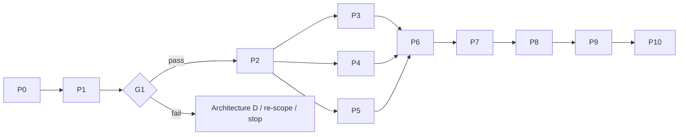

# Document 11 — Future Development Roadmap

> **Superseded by [Doc 18 §19](18-development-blueprint.md)** (Phases 1–10 with gates). Kept for history and effort ranges.

**Effort figures are rough planning ranges** for one experienced mobile engineer (person-weeks, pw), plus the specialists named. They are *estimates*, not commitments, and the variance is large because the gates can change the scope.

| Phase | Prerequisites | Outputs | Effort (range) | Measurable completion criteria | Go / no-go |
|---|---|---|---|---|---|
| **P0 Research completion** | — | This 13-document package | done | Product owner reviews; open questions accepted | **G0**: proceed to P1 or revise |
| **P1 Feasibility experiments** | Device lab (Doc 13 §5); minimal native test apps (Swift, Kotlin) — throwaway | E1, E2, E3 (partial), E5 (baseline), E14 results; user interviews (Doc 9 §6.3) | 3–6 pw | All E1 matrix cells measured on ≥ 2 iOS and ≥ 2 Android devices; E2 8-hour runs ×3 | **G1 Transport**, **G3 Energy (baseline)** |
| **P2 Architecture approval** | P1 data | Updated ADRs (ADR-003 parameters; ADR-004 core language stays **provisional** — final decision at the end of P3, per ADR-004/R-22); decision gates evaluated per Doc 14 §11; licence decision; legal review of crypto/export and store policies | 1–2 pw + counsel | Signed-off ADR set; licence chosen | Proceed or re-scope (Architecture D) |
| **P3 Transport proof of concept** | P2 | Native BLE adapters (dual role, fragmentation, L2CAP trial, iOS restoration, Android FGS); link protocol L1 with Noise NN; Play internal-track submission for FGS review | 4–8 pw | E1/E3/E6 re-run on PoC code; ADR-004 measurement (engine-less vs Flutter engine wake) | R-07 and R-22 resolved |
| **P4 Security proof of concept** | P2 | Pairing cards + QR, K_pair derivation, wrap, vodozemac integration via FFI, test vectors, formal model draft (S-R2) | 4–8 pw (+ crypto reviewer consult) | Cross-platform test vectors pass; E16 pass | Crypto design frozen for MVP |
| **P5 Routing simulation** | Portable core skeleton (can run parallel to P3/P4) | Discrete-event simulator; E9 parameter study; E8 logic tests | 3–6 pw | Parameter recommendation with delivery/resource curves | **G2 (simulation half)** |
| **P6 MVP implementation** | P3, P4, P5 | Flutter UI, core complete (Doc 5 components 1–23), Class R/C stores, delivery states | 12–24 pw | Feature list (Doc 9 §2, Essential) complete; unit + conformance tests | — |
| **P7 Integration testing** | P6 | Automated multi-device tests where possible; E7, E8, E13, E15 | 4–8 pw | All pass on the recommended device tier | **G2** |
| **P8 Physical-device validation** | P7 | E4, E5 (full), E6, E10, E11 on release candidates; small pilot | 4–8 pw | Reports published internally; battery model finalised | **G3** |
| **P9 Independent security review** | P8 code freeze | External audit (protocol + implementation + mobile platform) | 4–8 calendar weeks (external) | No open high/critical findings | **G4** |
| **P10 Release readiness** | P9 | Store submissions, privacy policy, in-product limitation disclosures, E12 field pilot | 2–4 pw + pilot | E12 meets the Doc 9 §5 requirement | **G5** |

**Total to public release:** roughly 37–82 pw of engineering, plus the external audit and pilot, *if all gates pass*. This is a wide range by design.

## Critical path

## What must NOT start before G1

- Flutter UI work, store listings, and marketing claims about delivery.
- Any production crypto integration beyond test vectors.
