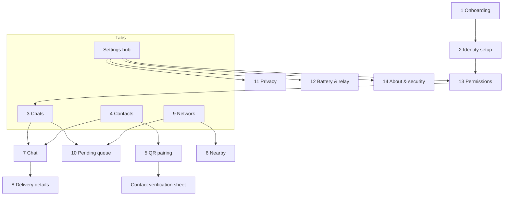

# Document 16 — UI/UX Specification

**Status:** design specification for implementation; **not implemented**.
**Platforms:** iOS 17+ and Android 12+ (API 31+), the proposed minimums in Doc 18 §4. **Implementation:** a Flutter UI layer (Doc 18 ADR-013).
**Companion skills available in this workspace for the UI phase:** `mobile-uiux-pro-max`, `mobile-flutter-design`, `flutter-accessibility`.

---

## 1. Design principles

| # | Principle | What it means on screen |
|---|---|---|
| D1 | **Truth over reassurance** | Delivery states never overstate (Doc 18 §7.4). "Accepted by a relay" is never styled like "Delivered". |
| D2 | **Quiet privacy** | No avatars fetched from anywhere, no "people nearby" lists, no online presence, no typing indicators. Privacy is the default and needs no explanation to stay on. |
| D3 | **Explain the physics** | Every waiting state says *why* it waits ("Messages move when devices meet"). |
| D4 | **Calm, premium minimalism** | One accent colour, generous spacing, few borders, no gradients or glassmorphism over content. Motion is purposeful and subtle. |
| D5 | **Platform-respectful** | Native navigation idioms per platform (iOS large titles and back-swipe; Android Material 3 navigation bar and predictive back). Shared brand tokens. |
| D6 | **Accessible by construction** | WCAG 2.2 AA contrast (verified below), 44 pt / 48 dp targets, Dynamic Type / font scaling to 200 %, full screen-reader labels, Reduce Motion honoured. |
| D7 | **Seven states for every view** | Ideal, empty, loading, error, offline (the normal state here), success, permission-denied. Each is designed explicitly (from the `mobile-uiux-pro-max` skill's state law). |

## 2. Typography

The **platform system fonts** are used: SF Pro on iOS, Roboto on Android. This gives zero font dependencies and native Dynamic Type and font-scale behaviour. Monospace (SF Mono / platform monospace) is used only for fingerprints and safety numbers.

| Token | Size / line height (pt or sp, at 100 %) | Weight | Use |
|---|---|---|---|
| `display` | 28 / 34 | Bold | Onboarding titles |
| `title` | 22 / 28 | Semibold | Screen titles (iOS large-title collapses to 17) |
| `headline` | 17 / 22 | Semibold | Section headers, contact names |
| `body` | 16 / 22 | Regular | Messages, paragraphs |
| `callout` | 15 / 20 | Regular | Secondary rows |
| `caption` | 13 / 18 | Regular | Timestamps, delivery labels |
| `mono` | 15 / 22 | Medium, tabular | Safety numbers (grouped in 5-digit blocks) |

Never truncate message text. Allow two lines for contact names before ellipsis. Layouts must reflow at 200 % text size.

## 3. Colour system

Brand: neutral warm-grey canvas with a single **"signal blue"** accent. Status colours always come with an icon and a text label (never colour alone).

| Token | Light | Dark | Use |
|---|---|---|---|
| `bg` | `#F6F6F3` | `#0B0D10` | Canvas |
| `surface` | `#FFFFFF` | `#16191E` | Cards, sheets, input bar |
| `text` | `#121417` | `#ECEEF1` | Primary text |
| `text2` | `#565C64` | `#A4AAB3` | Secondary text |
| `accent` | `#1F4FD8` | `#8FA8FF` | Primary actions, links, own-bubble (light) |
| `onAccent` | `#FFFFFF` | `#0B0D10` | Text on accent |
| `bubbleOut` | `#1F4FD8` (text `#FFFFFF`) | `#2D4FB8` (text `#ECEEF1`) | Sent messages |
| `bubbleIn` | `#ECECE8` | `#23272E` | Received messages |
| `ok` | `#1E7A46` | `#5FD394` | Delivered / verified |
| `warn` | `#9A5B00` | `#F2B451` | Waiting long / unknown / battery |
| `err` | `#B3261E` | `#FF8A80` | Failed / expired / permission missing |
| `border` | `#8A9099` | `#6B727C` | Input outlines, dividers where needed |

**Computed WCAG contrast** (script run 2026-10-14):
- **Light:** text/bg 17.0 · text2/surface 6.75 · accent/surface 6.63 · onAccent/accent 6.63 · ok 5.35 · warn 5.43 · err 6.54 · border/surface 3.22.
- **Dark:** text/bg 16.7 · text2/surface 7.53 · accent/surface 7.73 · onAccent/accent 8.54 · ok 9.42 · warn 9.58 · err 7.72 · text/bubbleOut 6.18 · border/surface 3.63.
- **Result:** all text pairs ≥ 4.5:1 (AA) and all UI-component pairs ≥ 3:1.

The tokens are defined once in shared Dart (theme) and must not be hard-coded in widgets.

## 4. Spacing, shape, elevation

- **4 pt grid:** `xs 4 · s 8 · m 12 · l 16 · xl 24 · xxl 32 · xxxl 48`. Screen side gutter: 16 (phones), 24 (≥ 600 dp width).
- **Radii:** chips 8 · cards/rows 12 · bubbles 18 (4 on the tail corner) · bottom sheets 20 (top corners).
- **Elevation:** surfaces are distinguished by tone, not shadow. Shadows are used only for floating sheets (iOS) or M3 tonal elevation (Android).
- **Touch targets:** ≥ 44 × 44 pt (iOS) / 48 × 48 dp (Android), even when the visual element is smaller.

## 5. Motion

- **Durations:** 150 ms (micro: toggles, chips), 250 ms (navigation, sheets), 400 ms max (onboarding illustrations).
- **Easing:** platform standard curves (iOS spring defaults; M3 emphasised easing).
- Delivery-state changes use a **crossfade plus icon morph** (no bounce), so a state change is noticed but is not celebratory.
- Live relay activity indicator: a slow 2 s breathing pulse on the network chip; **disabled with Reduce Motion**, replaced by a static dot.
- Never animate message text.

## 6. Navigation model



- **Four top-level destinations:** Chats, Contacts, Network, Settings.
  - iOS: bottom tab bar.
  - Android: Material 3 navigation bar.
  - At ≥ 840 dp width (tablets, foldables): a navigation rail plus a list-detail layout for Chats.
- **Global network chip** in the Chats header shows the relay state: Relaying / Paused / Bluetooth off / Permission needed. Tapping it opens Network.

## 7. Components

| Component | Variants / notes |
|---|---|
| Conversation row | Name, last message preview (privacy setting can hide previews), time, **delivery glyph of the last outgoing message** |
| Message bubble | Out/in; long-press → copy, delivery details, delete locally. Footer: time + delivery glyph + label (Dynamic Type safe) |
| **Delivery glyph set** | Five glyphs plus their colour (Doc 18 §7.4):<br>• Queued: clock outline, `text2`<br>• Accepted by relay: single arrow-in-circle, `text2`<br>• Delivered: check in filled circle, `ok`<br>• Read (optional): double check, `ok`<br>• Delivery unknown: dotted circle, `warn`<br>• Expired / failed: exclamation, `err`<br>Each has a text label for screen readers and in the details view |
| Network chip | State + icon; pulse animation (Reduce-Motion aware) |
| Safety-number block | 12 groups × 5 digits, mono, selectable; "Mark as verified" button |
| QR panel | High-contrast black-on-white module area, always light even in dark mode, quiet zone ≥ 4 modules, screen brightness boost while shown |
| Banner | Info / warn / err with action ("Turn on Bluetooth"); never auto-dismiss errors |
| Empty-state block | Icon (line art), title, one sentence, one primary action |
| Settings row | Title, subtitle explaining the battery or privacy effect, control |

## 8. Required screens

Each screen spec lists **Purpose · Primary actions · States · Errors · Navigation**.

### 1. Onboarding

- **Purpose:** explain in 3 short pages:
  1. no internet needed;
  2. messages hop between nearby devices and can take minutes to days;
  3. you add contacts in person.
- **Actions:** Continue, Learn more (opens screen 14 content).
- **States:** first run only; skippable after page 1 (but page 3's limits are shown again before the first send).
- **Errors:** none.
- **Navigation:** → 2.

### 2. Identity setup

- **Purpose:** create device identity locally (keys generated on the device), choose a display name (optional, shared only inside pairing cards and profiles), and optional app lock (biometric).
- **Actions:** Create identity; Set name; Enable app lock.
- **States:** generating (progress < 1 s expected; show a spinner only if > 300 ms); done.
- **Errors:**
  - Secure storage unavailable → blocking error explaining that a device passcode is required for secure storage.
  - Entropy or key failure → retry; never continue with a partial identity.
- **Navigation:** → 13 (permissions) → 3.

### 3. Home (Chats)

- **Purpose:** list conversations sorted by last activity.
- **Actions:** open chat; new chat (contact picker); pull-to-refresh is **not** offered (nothing to fetch).
- **States:**
  - empty: "No conversations yet. Add a contact in person to start." → button to 5;
  - ideal;
  - relay paused (banner);
  - permission-denied (banner → 13).
- **Errors:** database locked before first unlock (rare) → "Unlock your phone to read messages."
- **Navigation:** → 7, 4, 9, 10.

### 4. Contact list

- **Purpose:** paired contacts, with verification state badges.
- **Actions:** Add contact (→ 5); open contact (profile: verify, rename locally, delete, re-pair); start chat.
- **States:** empty → "Contacts are added face-to-face by scanning QR codes"; revoked contact (strikethrough + "Re-pair needed").
- **Errors:** none local.
- **Navigation:** → 5, 7, verification sheet.

### 5. QR contact pairing

- **Purpose:** mutual in-person exchange of pairing cards.
- **Actions:** "Show my code" / "Scan their code" (segmented); both must complete. After both are done, show the safety number and "Compare numbers" (optional verification).
- **States:**
  - camera permission missing (→ request / settings link);
  - scanning;
  - scanned (waiting for the other side);
  - paired;
  - paired + verified.
- **Errors:**
  - Invalid or unsupported QR → "This isn't a VYRO LINK code" / "Ask them to update the app".
  - Signature failure → "Code could not be verified — scan again".
  - Self-scan → blocked.
  - Already paired → offer re-pair.
- **Wireframe:**

```
┌─────────────────────────────┐
│ ‹  Add contact              │
│ [ Show my code | Scan code ]│
│ ┌─────────────────────────┐ │
│ │      ▓▓ QR (light) ▓▓   │ │
│ │                         │ │
│ └─────────────────────────┘ │
│ Ask them to scan this code, │
│ then scan theirs.           │
│ ✓ They scanned you  ○ You scanned them │
└─────────────────────────────┘
```

- **Navigation:** → verification sheet → 7.

### 6. Nearby (network presence)

- **Purpose:** show *that* the network exists around you, **never who**.
  - Coarse anonymous count bucket of VYRO LINK devices met recently: none / 1–2 / 3–9 / 10+.
  - Last encounter time.
  - Whether this phone is currently relaying.
- **Actions:** Start or stop relaying (shortcut to 12).
- **States:** Bluetooth off; permission missing; scanning paused by the OS (iOS background note); no devices met in N hours ("Messages will wait until someone with VYRO LINK comes near").
- **Errors:** Bluetooth unsupported or hardware error.
- **Privacy note on screen:** "VYRO LINK never shows who is nearby."
- **Navigation:** from 9.

### 7. One-to-one chat

- **Purpose:** conversation with one contact.
- **Actions:** send text (≤ the MVP limit, with a live counter near the limit); long-press a message (details → 8, copy, delete locally); contact header → profile/verify.
- **States:**
  - first-message notice ("This message may take a while…");
  - contact unverified (subtle shield-outline badge, tap → verify);
  - composing while no relay is possible (banner: "Saved — will send when a device comes near");
  - expired/failed message styling.
- **Errors:** over-length text (inline counter turns `err`; send disabled); key/session error on decrypt → message placeholder "Couldn't decrypt — ask them to resend" (+ automatic undecryptable receipt, Doc 18 §7).
- **Wireframe:**

```
┌─────────────────────────────┐
│ ‹  Asha  🛡✓            ⋯   │
│         Today               │
│  ┌──────────────┐           │
│  │ At the north │           │
│  │ gate at 6?   │           │
│  └──────────────┘ 17:02     │
│           ┌───────────────┐ │
│           │ Yes, see you  │ │
│           └───────────────┘ │
│        17:05 ◌ Accepted by relay │
│ ⓘ Saved. It travels when    │
│   phones meet.              │
│ [ Message…            ] [➤] │
└─────────────────────────────┘
```

- **Navigation:** → 8, contact profile.

### 8. Message delivery details

- **Purpose:** an honest timeline for one message.
- **Content:** Created → Queued → *n* relays accepted a copy (count only, with times) → Delivered (receipt verified) / Read / Expired / Delivery unknown. Plus expiry time remaining, "What these mean" explainer, and resend (re-encrypts with the same message identity) when Expired/Unknown/Failed.
- **States:** each terminal and non-terminal state, explained in plain language.
- **Errors:** none.
- **Navigation:** back to 7.

### 9. Network and relay diagnostics

- **Purpose:** user-level diagnostics.
- **Content:** relay on/off; Bluetooth state; permissions; envelopes carried for others (count, storage used vs cap); encounters in the last 24 h (count only); last successful exchange; outbound queue size; battery mode.
- **Advanced section** (collapsed): link-session success rate, average session time, last errors. Export a diagnostics bundle **only on explicit user action**, scrubbed of identifiers (Doc 18 §14).
- **States:** healthy / degraded / stopped (with causes).
- **Navigation:** → 6, 10, 12, 13.

### 10. Pending message queue

- **Purpose:** the user's own outgoing messages not yet acknowledged, grouped by contact, with state and time to expiry.
- **Actions:** open the message's details (8); delete locally. Copies already with relays cannot be recalled; this is stated.
- **States:** empty ("Nothing waiting"); items in Queued / Accepted by relay / Delivery unknown.
- **Navigation:** from 3, 9.

### 11. Privacy settings

Controls (defaults in **bold**):
- message previews in notifications (**off**);
- read receipts (**off**);
- app lock (**off**, recommended on);
- show delivery details (**on**);
- screen-capture protection on Android (**on**);
- clear all data (crypto-shred, confirmation required).

Each control explains its effect in one sentence.

### 12. Battery and relay settings

- **Relay participation:**
  - **Android:** Off / **While charging** / Always (Always uses the persistent foreground-service notification).
  - **iOS:** On/Off. Explains that the system limits background relaying and that force-quitting stops it.
- **Storage for others' messages:** cap slider within a safe range (default TBC by Experiment C / Doc 18 §15).
- **Battery cost:** "Measured cost on this device" is shown only once data exists; before that, "Not yet measured".
- **Navigation:** from Settings, 6, 9.

### 13. Permissions and troubleshooting

- **Purpose:** educate before the system prompt; recover after denial.
- **Items:** Bluetooth; Nearby devices (Android); notifications; camera (pairing only, requested just-in-time).
- **Content per item:** why it's needed, what is never done (no location tracking), and a status with an "Open Settings" deep link.
- **Troubleshooting checklist:**
  - Bluetooth on;
  - app not force-quit (iOS);
  - battery optimisation exemption guidance per OEM (Android, only if the user enables Always relay);
  - Low Power Mode note.
- **States:** granted / denied / restricted / not determined.

### 14. About and security information

Plain-language security model:
- what relays can and cannot see (Doc 06 §9);
- limitations (Doc 06 §10);
- the identity fingerprint;
- app version and protocol versions;
- open-source licences;
- independent review status ("Not yet independently reviewed" until P9 completes; **never claim otherwise**).

## 9. Empty, error, offline, and permission states (cross-cutting)

| Situation | Treatment |
|---|---|
| No internet | **Not an error.** Never shown as offline-red. The app is offline by design. |
| No nearby devices for a long time | Neutral info banner in Network and Chat; no alarm colours |
| Bluetooth off | `err` banner with "Turn on Bluetooth" (opens settings) |
| Permission denied | Blocking card on Chats/Network with "Fix" → 13 |
| Relay paused by OS/battery | `warn` chip; explanation in 9 |
| Storage cap reached (carrying) | Silent for the user (relay drops the oldest by expiry); visible in 9 |
| Device locked before first unlock | Notification-free; on unlock, messages appear |

## 10. Accessibility checklist (acceptance)

- Every control has an accessible label; delivery glyphs announce their state ("Accepted by a relay, not yet delivered").
- Dynamic Type / font scale up to 200 % without clipping (test at 100/150/200 %).
- Contrast pairs verified (§3). Focus order follows visual order. Hardware keyboard and switch-access navigable.
- Reduce Motion and Reduce Transparency honoured. No information conveyed by colour alone.
- Haptics: light impact on send and on verified pairing only.
- RTL layout mirrors correctly (bubbles, chevrons, timelines).

## 11. Responsive layouts

| Width class | Layout |
|---|---|
| Compact (< 600 dp) | Single column; bottom navigation |
| Medium (600–839) | Single column with wider gutters; bottom navigation |
| Expanded (≥ 840) | Navigation rail + list/detail (Chats ↔ Chat; Contacts ↔ Profile) |
