# Document 18 — VYRO LINK Development Blueprint (authoritative)

**Version:** 1.0 · **Date:** 2026-10-14 · **Status:** architecture **frozen for the MVP**, subject to the feasibility gates in §21.

**Supersedes on conflict:**
- Doc 05 ADR-004 (resolved by ADR-013);
- Doc 06/07 XChaCha20 wrap (replaced by ADR-014);
- Doc 07 §7 delivery states (replaced by §7.4);
- Doc 11 roadmap (replaced by §19).

All other documents remain valid evidence and detail. Doc 15 lists which document is authoritative for each topic.

> **Honesty statement.** No physical-device experiment has been run. Every capability marked *experimental* or *pending* below is unproven. This blueprint is **not** production-ready and describes a system that does not yet exist.

---

## 0. Authorisation summary

| Scope | Status |
|---|---|
| Phase 1 environment + repository initialisation | **Authorised after user approves installs** (C1) |
| Phase 2a native transport prototype + Experiments A and C (Doc 14) | **Authorised** (limited, throwaway prototype) |
| Phases 3–5: shared Rust core (crypto, persistence, protocol, routing, simulator) on desktop | **Authorised**: platform-independent, reversible |
| Phase 2b Experiment B (multi-hop on devices, using the core) | **Authorised** once Phases 3–5 reach their exit criteria |
| Phases 6–7 (mobile UI, native integration of the full app) | **Blocked** until gates GA and GB/GS pass |
| Phases 8–10 (integration testing, security review, release) | **Blocked** until Phases 6–7 complete; release needs gate G4 (independent review) |

---

## 1. Product requirements

- **Vision:** private 1:1 text messaging between iPhone and Android users **without internet, cellular service, or servers**. Messages are carried store-and-forward by nearby VYRO LINK devices, with honest delivery feedback.
- **Primary users (Doc 09 §1):** groups who know each other and are temporarily without connectivity: events, outdoor groups, campuses during outages. This is **not** emergency infrastructure.
- **MVP scope:**
  - offline 1:1 text;
  - multi-hop relaying (spray-and-wait);
  - in-person QR pairing with optional verification;
  - E2E encryption;
  - authenticated delivery receipts;
  - offline queue;
  - automatic discovery;
  - user-controlled relay participation;
  - expiry;
  - diagnostics.
- **Deferred:** §17.2.

## 2. Functional requirements

| ID | Requirement | Acceptance (Doc 17) |
|---|---|---|
| FR-01 | Create a device identity locally on first run; no account, phone number or server | T-CRY-01, T-UI-02 |
| FR-02 | Pair contacts by mutual QR scan; derive pairwise keys; show a safety number; allow "mark verified" | T-CRY-03…05, E16 |
| FR-03 | Compose and send text (≤ the MVP length limit set in §7.2) to a paired contact while fully offline | T-PRO-*, Exp B |
| FR-04 | Encrypt every message end to end; relays never receive plaintext or sender identity | T-CRY-06…10, Exp B5 |
| FR-05 | Discover nearby VYRO LINK devices over BLE and exchange envelopes automatically | Exp A |
| FR-06 | Relay others' envelopes within user-set limits (opt-in on Android "Always"; default "While charging") | T-RTE-*, Exp B/C |
| FR-07 | Deliver to the recipient over multiple hops and time-separated encounters | Exp B1–B3 |
| FR-08 | Return an authenticated delivery receipt; show "Delivered" **only** on a verified receipt | T-RTE-08, Exp B |
| FR-09 | Suppress duplicates across paths and retries | T-RTE-05, Exp B3 |
| FR-10 | Persist the queue and carried envelopes across app termination and reboot | T-DB-*, Exp B2 |
| FR-11 | Expire envelopes everywhere at expiry; show Expired / Delivery unknown honestly | T-RTE-10, Exp B4 |
| FR-12 | Diagnostics screen; user-initiated, scrubbed diagnostics export | T-UI-09 |
| FR-13 | Permission education and recovery flows | T-UI-13 |
| FR-14 | Local deletion of messages/conversations; crypto-shred "clear all data" | T-DB-08 |
| FR-15 | Key replenishment (OTKs) and identity rotation/revocation messages between contacts | T-CRY-11…13 |

## 3. Nonfunctional requirements

| ID | Requirement | Basis |
|---|---|---|
| NFR-01 | **No server dependency** for any MVP function | Brief; ADR-012 |
| NFR-02 | No network permission/entitlement in the MVP builds (Android: no `INTERNET`) | Metadata minimisation; testability |
| NFR-03 | Accessibility: WCAG 2.2 AA contrast (verified tokens, Doc 16 §3), 200 % text scaling, screen-reader labels | Doc 16 |
| NFR-04 | One protocol implementation for both platforms (shared core) with cross-platform test vectors | ADR-002/013 |
| NFR-05 | A link session must complete within the **measured** iOS background wake budget on target devices | Doc 14 HA2 (value pending) |
| NFR-06 | Battery cost of relay modes ≤ the user-elicited threshold | Doc 14 §8.2 (pending) |
| NFR-07 | Strict, bounded parsing of all radio input; no decompression anywhere | Doc 06 §7, [S28, S29] |
| NFR-08 | All persisted data encrypted at rest (SQLCipher) with OS-protected keys | ADR-010 |
| NFR-09 | No telemetry, analytics, or third-party SDKs that transmit data | Privacy |
| NFR-10 | Reproducible builds of the core; dependency audit (cargo-audit/deny, OSV) in CI | Doc 17 |

## 4. Platform compatibility

| Item | Decision | Status |
|---|---|---|
| Minimum iOS | **iOS 17.0** (proposal, ADR-016) | User may change; Core Bluetooth APIs used exist since iOS 11 [S69] |
| Minimum Android | **Android 12, API 31** (`minSdk 31`), `targetSdk 37` | Avoids location permission for BLE (`neverForLocation`, [S17]) |
| Devices | iPhone with BLE (all supported models); Android with BLE peripheral (advertising) support, checked at runtime | Unsupported Android devices: client-only mode |
| Simulators | **Not usable** for BLE; physical devices required | [S12] (no Simulator for Wi-Fi Aware); BLE absent in the iOS Simulator |

### 4.1 Capability matrix (final)

| Capability | iPhone↔iPhone | Android↔Android | iPhone↔Android | Status |
|---|---|---|---|---|
| Foreground discovery + GATT exchange | ✅ | ✅ | ✅ | **Verified (documented)**; interop quirks to measure (Exp A1) |
| Background iPhone discovered by Android | — | — | ❌ (overflow area unreadable [S15]) | **Verified negative (documented)** |
| Background iPhone discovers Android (FGS advertising) and connects | — | — | ⚠️ | **Experimental** (Exp A2/A3) |
| Background iPhone ↔ background iPhone | ⚠️ overflow discovery documented, slow | — | — | **Experimental** (Exp A-ext) |
| Android FGS ↔ Android FGS | — | ✅ (filtered scans continue screen-off [S67]) | — | **Documented**; OEM kills = experimental |
| Android without FGS | — | ⚠️ short `PendingIntent` wakes [S18] | ⚠️ | **Best-effort** |
| Force-quit iPhone / force-stopped Android | ❌ | ❌ | ❌ | **Cannot participate** (documented [S11]; Android stopped state, C) |
| Before first unlock after reboot (iPhone) | ❌ | | ❌ | **Documented** [S11] |
| Multi-hop forwarding | App-level (VYRO LINK) | App-level | App-level | **Designed; unproven** (Exp B) |
| L2CAP CoC upgrade | iOS 11+ [S69] | API 29+ [S68] | Both | **Optional**; enabled only if Exp A/E3 show a benefit |
| Wi-Fi Aware | iOS 26+, paired devices only [S12, S13] | Android 8+ hardware-dependent [S21] | Interop unproven [S16] | **Deferred** |
| Apple P2P Wi-Fi / Multipeer | Apple-only [S14] | — | ❌ | **Deferred** |
| Nearby Connections | ⚠️ | ✅ | ⚠️ claimed [S26] | **Optional / investigate** |
| Dedicated relay hardware | — | — | — | **Contingency (Architecture D)** |

---

## 5. Final architecture

### 5.1 Layering (ADR-013)

```
┌──────────────────────────── Flutter UI (Dart) — shared ─────────────────────────────┐
│ Screens (Doc 16) · view-models · theme tokens · QR camera (mobile_scanner)          │
└──────────────▲──────────────────────────────────────────────────────────────────────┘
               │ Pigeon-generated typed host API + event channel (foreground only)
┌──────────────┴─────────── Native host — per platform ───────────────────────────────┐
│ iOS (Swift): CBCentralManager+CBPeripheralManager (restore IDs), lifecycle,          │
│              Keychain KeyProvider, permissions                                       │
│ Android (Kotlin): BluetoothLeScanner/Advertiser/GattServer, FGS connectedDevice,     │
│              Keystore KeyProvider, permissions, boot receiver                        │
└──────────────▲──────────────────────────────────────────────────────────────────────┘
               │ UniFFI bindings (Swift/Kotlin) — the core runs WITHOUT Flutter
┌──────────────┴─────────── VL Core (Rust) — shared, also builds for desktop ──────────┐
│ vl-proto (codec) · vl-crypto (vodozemac, ChaCha20-Poly1305, HKDF/HMAC, X25519, snow)  │
│ vl-store (SQLCipher: Class R db, Class C db) · vl-link (session state machine)        │
│ vl-routing (direct + spray-and-wait, dedup, vaccines, receipts, expiry, quotas)       │
│ vl-core (facade, scheduler, events) · vl-sim (desktop DTN simulator) · vl-vectors     │
└───────────────────────────────────────────────────────────────────────────────────────┘
```

**Key property:** background relaying is **native + Rust only**. iOS state-restoration relaunches and Android FGS work never need the Flutter engine. Flutter runs only while the UI is visible. This removes R-22 by design.

### 5.2 Component ownership

| Component (Doc 05 §2 #) | Owner | Shared? |
|---|---|---|
| Presentation, state mgmt (1, 2) | Flutter | Shared |
| Contacts & identity (3), crypto (10, 11), serialization (9), queue (14), routing (15), dedup (16), acks (17), expiry (18), abuse (19), diagnostics core (20), battery policy (21) | Rust core | Shared |
| Local encrypted storage (12) | Rust core (SQLCipher) + native KeyProvider (13) | Shared logic, native keys |
| Peer discovery (4), BLE transport (6), connection manager (8), permissions (22), lifecycle (23) | Native host | **Native** per platform; policies from the core |
| Transport abstraction (5) | Rust trait `TransportDriver` implemented natively | Interface shared |

### 5.3 Framework decision (ADR-013), trade-offs

| Option | Shared logic | Background fit | UI polish | Consistency | Maintenance | Verdict |
|---|---|---|---|---|---|---|
| **Flutter UI + native host + Rust core (chosen)** | One core for both + desktop simulator | Excellent (no Dart in background) | One polished UI, platform-adaptive | Highest (single protocol impl.) | 4 languages; UniFFI + Pigeon codegen | **Chosen** |
| Flutter with Dart core + BLE plugins | One Dart core | Poor/unproven: needs a headless engine in ~10 s wakes; plugins such as flutter_blue_plus are central-only and commercially licensed [S47] | Good | Good | Plugin dependency risk (R-15) | Rejected |
| Fully native (SwiftUI + Compose), Rust core | One core | Excellent | Two UIs to build/maintain | Core consistent, UI diverges | 2 UI codebases | **Fallback** if Flutter–native integration proves costly (reversible: core + host unchanged) |
| Kotlin Multiplatform core | One core (Kotlin) | Good | Either | Good | No audited Olm in Kotlin; crypto via JNI/Swift wrappers | Rejected (crypto libraries) |
| Two native apps, no shared core | None | Excellent | Two UIs | **Protocol drift risk** (bitchat pattern [S27, S27a]) | Highest | Rejected |

**Why not commit to Flutter for convenience?** Flutter is used **only** where it is strongest: one polished UI. Everything OS-sensitive (BLE roles, background, keys, lifecycle) is native, and everything protocol-sensitive is in one Rust core. If the Flutter layer becomes a liability, it can be swapped for native UIs without touching the protocol or transport (the fallback row).

### 5.4 Transport selection (final)

| Role | Choice |
|---|---|
| Primary | **BLE GATT**, dual role (central + peripheral) on every device. One fixed 128-bit service UUID; **no identity in advertisements** |
| Upgrade (per link, after HELLO) | BLE L2CAP CoC, **only if** measurements show a gain (Exp A/E3) |
| Discovery initiation rule | Any device that discovers a peer may connect. **Backgrounded iPhones initiate to Android**; Android does not attempt blind connections to Apple devices (privacy; Doc 14 §3.3) |
| Fallback | If L2CAP fails → GATT. If the peripheral role is unsupported on an Android device → central-only client. If Bluetooth is off → queue only |
| Deferred | Wi-Fi Aware (paired contacts), Apple P2P (iOS↔iOS), Nearby Connections, same-AP LAN |
| Contingency | Architecture D relay hardware if gate GA fails |

**Direct P2P ≠ multi-hop.** None of the transports above routes messages. Multi-hop is always VYRO LINK's own store-and-forward layer (§7).

### 5.5 Relay classes (new in protocol v1, ADR-019)

Every device declares `relay_class` in `HELLO`:
- `always_on`: Android "Always" relay mode;
- `best_effort`: iPhone, or Android "While charging" while charging;
- `endpoint_only`: relay off.

When spraying, the routing engine prefers `always_on` neighbours among those simultaneously available. Endpoint-only devices still send and receive their own mail.

### 5.6 Architecture decision records added in this phase

| ADR | Decision | Alternatives rejected | Evidence | Reversibility | Changes if… |
|---|---|---|---|---|---|
| **ADR-013** | Flutter UI + native Swift/Kotlin hosts + shared Rust core (UniFFI); Pigeon between Flutter and the host | Dart core + plugins; KMP core; two native apps; fully native UIs (kept as fallback) | §5.3; [S47, S80]; bitchat two-codebase drift risk [S27, S27a] | UI layer high; core medium | Flutter–host integration costs exceed the benefit → native UIs |
| **ADR-014** | Wrap AEAD = ChaCha20-Poly1305 (RFC 8439), random 96-bit nonce, per-direction keys, ≤ 2²⁰ envelopes per key | XChaCha20-Poly1305 (no authoritative spec [S81]); AES-GCM (no benefit; nonce misuse risk equal) | [S76, S81] | High (inner/outer version) | A standardised XChaCha appears and is audited |
| **ADR-015** | Only a verified `RECEIPT_DELIVERED` sets the Delivered UI state; `DELIVERED_LOCAL` is diagnostic | Trusting the direct-delivery custody claim | Tags visible to relays; anonymous links (Doc 06 §9) | High | Never (security invariant) |
| **ADR-016** | Minimum iOS 17, Android 12 (API 31), targetSdk 37 | Lower minimums (need location permission for BLE below API 31 [S17]) | [S17, S68] | Medium | User decision U-5 |
| **ADR-017** | Fixed binary header + TLV link messages; no protobuf/CBOR in the core | protobuf, CBOR, BPv7 | ADR-006; parser-attack lessons [S28, S29] | Medium (versioned) | Interop with an external ecosystem becomes a goal |
| **ADR-018** | SQLite + SQLCipher via rusqlite (`bundled-sqlcipher-vendored-openssl`), two DB files (Class R / C) | Dart DBs (drift/sqflite); platform-native DBs per OS | [S82, S83]; ADR-010 | Medium | SQLCipher build issues per platform → evaluate alternative at-rest encryption with the same two-class design |
| **ADR-019** | `HELLO.relay_class` (always_on / best_effort / endpoint_only); spray prefers always_on | No relay classes | Doc 14 §12 fallback needs | High | — |

---

## 6. Module boundaries and APIs (conceptual; names are normative, signatures indicative)

### 6.1 Rust core facade (exposed to Swift/Kotlin via UniFFI)

| Group | Operations |
|---|---|
| Lifecycle | `init(config, key_provider, transport_driver, event_sink)`; `set_app_state(Foreground\|Background\|Locked)`; `on_device_unlocked()`; `run_maintenance(now)` (GC by expiry; called on every wake) |
| Identity | `create_identity(display_name?)`; `pairing_card() -> bytes`; `inspect_card(bytes) -> CardPreview \| Error`; `complete_pairing(card) -> ContactId`; `safety_number(contact) -> String`; `set_verified(contact, bool)`; `rotate_identity()`; `delete_contact(contact)` |
| Messaging | `send_text(contact, text) -> MessageId`; `conversations()`; `messages(contact, cursor)`; `message_detail(id) -> Timeline`; `resend(id)`; `delete_local(id)`; `clear_all_data()` |
| Transport ingress (native → core) | `peer_discovered(peer_handle, rssi, platform_hint) -> ConnectDecision`; `link_opened(link_id, transport, mtu, role)`; `frame_received(link_id, bytes)`; `link_closed(link_id, reason)` |
| Settings | `set_relay_mode(mode)`; `set_carry_cap(bytes)`; `set_privacy(options)` |
| Diagnostics | `diagnostics_snapshot()`; `export_diagnostics() -> bytes` (scrubbed; user action only) |

### 6.2 Foreign traits implemented natively

| Trait | Methods | Implemented by |
|---|---|---|
| `TransportDriver` | `connect(peer_handle)`; `send_frame(link_id, bytes)`; `close(link_id)`; `set_discovery_policy(scan_duty, advertise, relay_class)` | Swift / Kotlin BLE adapters |
| `KeyProvider` | `db_key(class: R \| C) -> [u8; 32]` (create on first use; Keychain/Keystore with the class's accessibility) | Swift / Kotlin |
| `EventSink` | `message_state_changed`, `message_received`, `network_status`, `relay_stats` | Native host → forwards to Flutter via Pigeon when the UI is attached |

**Concurrency:** the core is a single logical actor with an internal queue. All entry points are non-blocking; native adapters call from background queues. UniFFI's support for *async* foreign traits must be confirmed in Phase 1; if it is unavailable, the design uses synchronous foreign calls plus core-side queuing ([S80], R-30).

### 6.3 Native host ↔ Flutter (Pigeon)

| API | Content |
|---|---|
| HostApi | A subset of the core facade the UI needs, plus `permissionsStatus()`, `openSystemSettings(kind)`, `requestPermission(kind)`, `bluetoothState()` |
| FlutterApi (events) | Message and conversation updates, network chip state, permission changes |

**Rule:** the Flutter layer never holds keys, never parses envelopes, and never talks to Bluetooth.

---

## 7. Message protocol and routing (final)

**Wire formats:** Doc 07 L0–L3 remain normative, with these **final changes**:

| Change | Detail | Reason |
|---|---|---|
| ADR-014 wrap AEAD | **ChaCha20-Poly1305 (RFC 8439)** with a random 96-bit nonce per envelope, per-direction keys. Body = `nonce(12) ‖ ciphertext ‖ tag(16)`. Hard cap **2²⁰ envelopes per key direction**, then AK rotation is required. | RustCrypto states "No authoritative specification exists for XChaCha20Poly1305" [S81]. The RFC 8439 construction is what NCC reviewed [S76]; platform-native on both OSes (useful for the probe). The collision bound is negligible at this cap (~2⁻⁵⁷) |
| ADR-015 | `CUSTODY=DELIVERED_LOCAL` is **diagnostic only**; it never sets Delivered | A relay can falsely claim to be the recipient: tags are visible, and links are anonymous |
| ADR-019 | `HELLO.relay_class` field (§5.5) | Supports the iPhone-endpoint fallback without a version break |
| New inner type `0x22 RECEIPT_UNDECRYPTABLE` | Wrap-authenticated; sent when the outer unwrap succeeded but Olm decryption failed (e.g. session state lost) | Sender learns to resend with a fresh session; avoids a silent "Delivered" for unreadable content |

### 7.1 Identifiers and metadata

| Field | Visible to | Purpose |
|---|---|---|
| `envelope_id` (16 B random) | Relays | Relay dedup, custody, vaccine binding |
| `message_id` (16 B random, inner) | Sender + recipient | Recipient dedup across re-encryptions; UI identity |
| `recipient_tag` (16 B, pairwise epoch HMAC) | Relays (opaque) | Recipient recognition |
| Sender identity | **Recipient only** (inside Olm) | Authentication |
| `expiry` (unix minutes, ±30 min sender jitter) | Relays; AAD-authenticated at the recipient | Lifetime |
| `hop_count` / `hop_limit` (default 8) | Relays (hop_count mutable) | Loop safety |
| `copy_budget` (L = 4, cap 8) | Relays (mutable, clamped) | Spray control |
| `ack_commitment` | Relays | Vaccine matching |
| Size bucket | Relays / sniffers on unencrypted air (link is encrypted) | Padding |

### 7.2 Parameters (provisional until E9/Exp B/C; all in one config)

| Parameter | Initial value | Source |
|---|---|---|
| Max text length | **1,700 UTF-8 bytes** (fits the 2,048 bucket after inner header + Olm overhead; the exact limit is confirmed in Phase 4 test vectors) | Doc 07 |
| Default expiry / local max | 72 h / 7 d (+2 h skew margin) | Doc 06 §7 |
| Copy budget L / cap | **8 / 8** (was 4 / 8; ADR-021, approved 2026-10-15) | ADR-003, ADR-021 |
| Sender auto-retry | One re-spray at 25 % of lifetime if no receipt and budget exhausted | Doc 05 §5 |
| Carry-store cap | 10 MB default (user-adjustable) | Provisional (Exp C, E9) |
| Per-session acceptance | ≤ 32 envelopes and ≤ 64 KiB per link session | Provisional |
| Per-tag cap per relay | ≤ 8 envelopes | Provisional |
| Tag epoch | 6 h | ADR-009 |
| MAX_SKIP (Olm) | 1,000; skipped keys deleted at expiry | Doc 06 §5 |

### 7.3 Routing algorithm (normative description)

On every link session, after Noise NN and HELLO:

1. **Vaccines first:** exchange delivered-proof lists; purge matching carried and outbox envelopes.
2. **Deliver:**
   - Each side sends a `SUMMARY` of what it carries.
   - The peer `REQUEST`s (role DELIVER) the envelopes whose tags are in its tag table.
   - The carrier sends them and **keeps its copy** until a vaccine, expiry or quota eviction removes it. The recipient's claim is not trusted.
3. **Spray:**
   - For each carried or outbox envelope with budget n > 1 that the peer lacks and accepts (role CARRY, within its quotas), send it with budget ⌊n/2⌋ and keep ⌈n/2⌉.
   - Prefer `always_on` peers when several are connected.
4. **Wait:** budget 1 → DELIVER only.
5. **Receipts** are ordinary envelopes (type RECEIPT) and follow steps 2–4.
6. **Retry:** the sender's single automatic re-spray (§7.2).
7. **Maintenance:** GC by expiry at every wake.

**Relay failure:**
- A relay that disappears keeps its copy and may deliver later, or never.
- Spray to multiple carriers plus the sender retry reduces the risk of a black hole (T13).
- Nothing is lost at the sender while it is unexpired.

**Multiple paths:** relays dedup by `envelope_id` (SeenSet until expiry). Recipients dedup by `message_id` and display once. Vaccines spread on later encounters and purge remaining copies.

**Recipient unavailable for hours or days:** copies persist at the sender and carriers until expiry (default 72 h). Then the sender shows **Delivery unknown** (if handed off) or **Expired** (if never accepted), with an option to resend (new envelope, same message_id, new expiry).

### 7.4 Delivery-state model (final; supersedes Doc 07 §7)

**Sender-side message states** (persisted, shown in the UI):

| State | Exact meaning | UI label |
|---|---|---|
| `QUEUED` | Encrypted envelope persisted in the outbox; no neighbour has completed receipt of it | "Waiting for nearby devices" |
| `SENT_TO_NEARBY` | ≥ 1 `ENVELOPE` frame fully written to a neighbour link, but no custody confirmation (link dropped) | "Waiting for nearby devices" (diagnostic detail only) |
| `ACCEPTED_BY_RELAY` | ≥ 1 neighbour returned `CUSTODY=ACCEPTED` (or `DELIVERED_LOCAL`, ADR-015). **The intended recipient has not necessarily received it** | "Accepted by a relay (n)" |
| `ACKNOWLEDGED` | A wrap-authenticated `RECEIPT_DELIVERED` for this message_id was verified. **This is the only state shown as "Delivered".** | "Delivered" |
| `READ` | Verified `RECEIPT_READ` (feature off by default) | "Read" |
| `EXPIRED` | Expiry passed and no neighbour ever accepted a copy | "Not delivered (expired)" |
| `DELIVERY_UNKNOWN` | Expiry passed after ≥ 1 handoff, with no receipt. It may have been delivered and the receipt lost | "Delivery unknown" |
| `FAILED` | Local terminal error: encryption failure, contact revoked, storage error, or `RECEIPT_UNDECRYPTABLE` received and the automatic resend also failed | "Failed — tap for details" |

**Relay-side record states** (never visible to the sender):
- `CARRYING` (budget > 1);
- `WAITING` (budget = 1);
- **`FORWARDED`**: this relay gave ≥ 1 copy onward and keeps its share; it is a relay-local fact and is never reported to the sender;
- `PURGED{vaccine | expiry | quota}`.

**Recipient-side states:**
- **`DELIVERED`** = the recipient device unwrapped and stored the envelope (possibly while locked); this triggers `RECEIPT_DELIVERED`;
- `DECRYPTED` (after unlock);
- `UNDECRYPTABLE` (triggers `RECEIPT_UNDECRYPTABLE`).

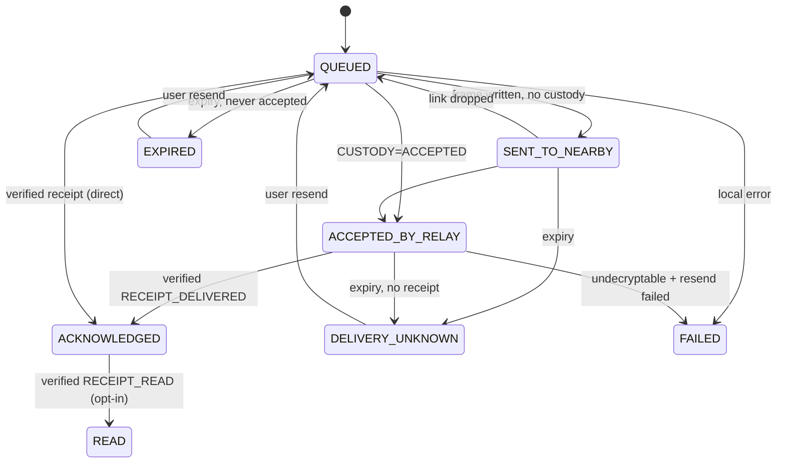

**Aliases in earlier documents:** `HANDED_OFF` = `ACCEPTED_BY_RELAY`; `UNKNOWN` = `DELIVERY_UNKNOWN`; sender-side `DELIVERED` (Doc 07 §7) = `ACKNOWLEDGED`; `DELIVERED_DIRECT` was removed (ADR-015).

**Invariant (tested, T-RTE-08):** no code path sets `ACKNOWLEDGED` without verifying a receipt wrap tag under `K_wrap(recipient→sender)`.

### 7.5 Deletion

- **Local delete:** removes the message rows and crypto-shreds per-message material where Olm provides it. SQLite `secure_delete` is enabled, but flash remanence is not guaranteed (Doc 06 §6).
- **Copies already with relays cannot be recalled.** Sender-initiated purge via early vaccine release ("best-effort unsend") is **deferred** (§17.2).

### 7.6 Versioning

As in Doc 07 §9: the `HELLO` negotiates the link version; envelope versions are rolled out carry-first; Class R can be rebuilt; Class C migrations are lossless.

---

## 8. Security model (final)

### 8.1 Cryptographic suite (no new primitives)

| Function | Primitive | Library (Rust) | Evidence |
|---|---|---|---|
| E2E sessions | Olm (Double Ratchet + 3DH) with one-time + fallback keys | **vodozemac 0.11.x** (Apache-2.0) | Least Authority audit 2022 [S45]; 2 low-severity advisories (2024) fixed [S77] |
| Identity signatures | Ed25519 (Olm account fingerprint key) | vodozemac | as above |
| Pairwise secret | X25519 + HKDF-SHA256 | **x25519-dalek 3.x / curve25519-dalek 5.x** (BSD-3); **hkdf**, **hmac**, **sha2** (RustCrypto, Apache-2.0 OR MIT) | Quarkslab audit of dalek 2019 [S78]; RUSTSEC-2024-0344 timing issue fixed ≥ 4.1.3 [S79]. **No audit found for the hkdf/hmac/sha2 crates specifically** (gap) |
| Envelope wrap | ChaCha20-Poly1305 (RFC 8439) | **chacha20poly1305 0.11** (Apache-2.0 OR MIT) | NCC Group review of RustCrypto ChaCha20Poly1305, 2020 [S76] (older version; re-review recommended) |
| Tags / ack commitments | HMAC-SHA256 / SHA-256 (truncated to 128 bits) | RustCrypto | as above |
| Link encryption | `Noise_NN_25519_ChaChaPoly_SHA256` | **snow 0.10.x** (Apache-2.0 OR MIT) | No audit found; GHSA-7g9j (nonce increment, medium) fixed in 0.9.5 [S77] |
| At-rest DB | SQLCipher 4.x | **rusqlite 0.40 `bundled-sqlcipher-vendored-openssl`** [S82]; SQLCipher (BSD-3) + OpenSSL | No public independent SQLCipher audit found; 2 DoS CVEs fixed [S83] |
| DB keys | 256-bit random | Keychain (`AfterFirstUnlockThisDeviceOnly` for R; `WhenUnlockedThisDeviceOnly` for C) / Android Keystore (`setUnlockedDeviceRequired` for C) | Doc 06 §6 |
| Randomness | OS CSPRNG | `getrandom` | — |

**Mandatory dependency hygiene:** pin exact versions; run `cargo-audit` / `cargo-deny` and OSV-Scanner in CI; reject the known-vulnerable ranges above.

### 8.2 Pairing, verification, rotation, revocation

- **Pairing:** Doc 06 §3.2 (mutual QR; signed Pairing Card; X25519 → HKDF → directional `K_tag`/`K_wrap`; safety number).
- **Verification:** optional in-person safety-number comparison.
- **Rotation:** `KEY_UPDATE` (OTK replenishment, AK rotation, mandatory before 2²⁰ envelopes per direction).
- **Revocation:** `REVOKE` signed by the old identity. A **lost device cannot be revoked remotely** (residual).

### 8.3 Relay privacy: what relays *can* infer (no overstated claims)

**Relays learn:**
- envelope IDs, recipient tags (grouped per 6 h epoch per direction), coarse expiry, size bucket, hop and budget counters;
- when and from which anonymous link an envelope arrived;
- whether an envelope was later vaccinated (delivered).

**A carrier that delivers directly learns** that the anonymous peer it met holds the tag (it may infer "this device is the recipient of these messages, this epoch").

**Passive observers learn** that a VYRO LINK device is present (fixed service UUID) and its traffic volume and timing.

**Contacts** can recognise their own pairwise tags.

### 8.4 Abuse, storage and battery protections

As Doc 06 §7, with the provisional values in §7.2 here. **Sybil resistance is weak by construction** (anonymous links). The damage a Sybil can do is bounded by budgets, caps and expiry, not prevented.

### 8.5 Residual risks and review-required properties

**Residual risks:** Doc 06 §10, plus:
- no forward secrecy for the outer wrap/tag layer;
- no post-quantum protection (Olm);
- stolen after-first-unlock device exposes pairwise keys (T11);
- lost-device revocation.

**Must be independently reviewed before public release (G4):**
1. pairing and key derivation;
2. wrap + tag construction and nonce handling;
3. Olm integration (session handling, OTK/fallback, skipped keys);
4. Noise NN integration;
5. receipt authentication and the ACKNOWLEDGED invariant;
6. parser robustness (fuzzing results);
7. storage-class usage on both OSes;
8. relay metadata leakage.

---

## 9. Data model

### 9.1 Databases

| DB | File protection | Key | Rebuildable? |
|---|---|---|---|
| `vl_r.db` (Class R) | iOS `CompleteUntilFirstUserAuthentication`; Android credential-encrypted storage | `KeyProvider.db_key(R)` | Yes (losing carried mail is acceptable) |
| `vl_c.db` (Class C) | iOS `Complete`; Android credential-encrypted + unlocked-device-required key | `KeyProvider.db_key(C)` | **No**: lossless migrations |

Cross-database links use **opaque random refs** (`contact_ref`, `message_ref`), never names.

### 9.2 Schema (conceptual)

**Class R**

| Table | Columns (key → type) | Indexes |
|---|---|---|
| `meta` | key TEXT PK, value BLOB (schema_version, counters) | — |
| `pair_keys` | contact_ref BLOB(16) PK, k_tag_in, k_tag_out, k_wrap_in, k_wrap_out BLOB(32), wrap_out_count INT, ak_epoch INT | — |
| `tag_table` | tag BLOB(16) PK, contact_ref, epoch INT, direction INT | (epoch) |
| `carried` | envelope_id BLOB(16) PK, header BLOB(62), body BLOB, recipient_tag BLOB(16), expiry INT, copy_budget INT, hop_count INT, received_at INT, state INT, size_bucket INT | (expiry), (recipient_tag), (state) |
| `outbox` | envelope_id PK, message_ref BLOB(16), header, body, expiry, copy_budget INT, attempts INT, accepted_count INT, next_retry_at INT, retried BOOL, state INT | (expiry), (next_retry_at), (message_ref) |
| `seen` | envelope_id PK, expiry INT | (expiry) |
| `vaccine` | ack_commitment BLOB(16) PK, ack_secret BLOB(16), expiry INT | (expiry) |
| `pending_inbound` | envelope_id PK, contact_ref, inner_header BLOB, olm_payload BLOB, received_at INT, expiry INT | (contact_ref) |
| `quota` | scope TEXT, key BLOB, window_start INT, count INT, bytes INT; PK(scope, key, window_start) | (window_start) |
| `diag_counters` | day INT, name TEXT, value INT; PK(day, name) | — |

**Class C**

| Table | Columns | Indexes |
|---|---|---|
| `meta` | key PK, value | — |
| `identity` | id INT PK (=1), olm_account_pickle BLOB (encrypted by DB), display_name TEXT, card_hash BLOB, created_at INT | — |
| `contact` | contact_id BLOB(16) PK, contact_ref BLOB(16) UNIQUE, display_name TEXT, olm_identity_key, olm_fingerprint_key, ak_pub BLOB(32), verified BOOL, state INT, paired_at INT | (state) |
| `olm_session` | session_id TEXT PK, contact_id FK, pickle BLOB, last_used INT | (contact_id, last_used) |
| `message` | message_id BLOB(16) PK, message_ref BLOB(16) UNIQUE, contact_id FK, direction INT, body TEXT, sent_at INT, created_at INT, state INT, expiry INT | (contact_id, created_at), (state) |
| `message_event` | id INT PK, message_id FK, at INT, kind INT, detail BLOB | (message_id, at) |
| `settings` | key PK, value | — |

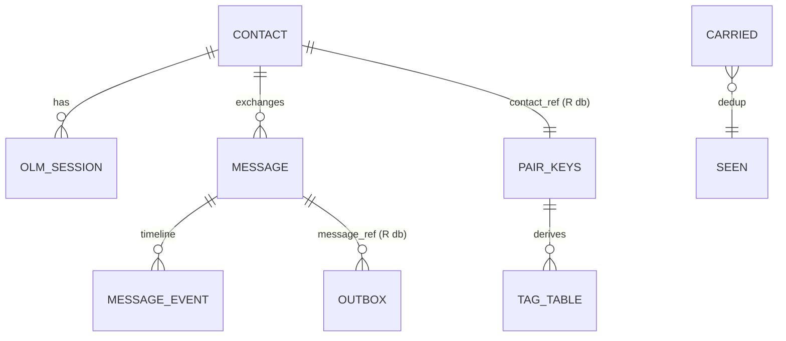

### 9.3 Expiry and GC

`run_maintenance(now)` runs on every wake, foreground entry and session start:
- deletes rows with `expiry < now` from `carried`, `outbox` (moving messages to EXPIRED / DELIVERY_UNKNOWN), `seen`, `vaccine`, `pending_inbound` and `quota`;
- regenerates `tag_table` for the active epoch window;
- prunes skipped Olm keys past expiry.

All deletes are index-driven and bounded per call (batching) so they fit inside the wake budget.

### 9.4 Migrations

- `meta.schema_version` per DB; forward-only migrations in `vl-store`.
- **Class R:** on unknown or failed migration, drop and recreate.
- **Class C:** migrate inside a transaction after an encrypted backup copy; tested against fixture databases from every released schema.

---

## 10. Architecture diagrams (final)

### 10.1 System context

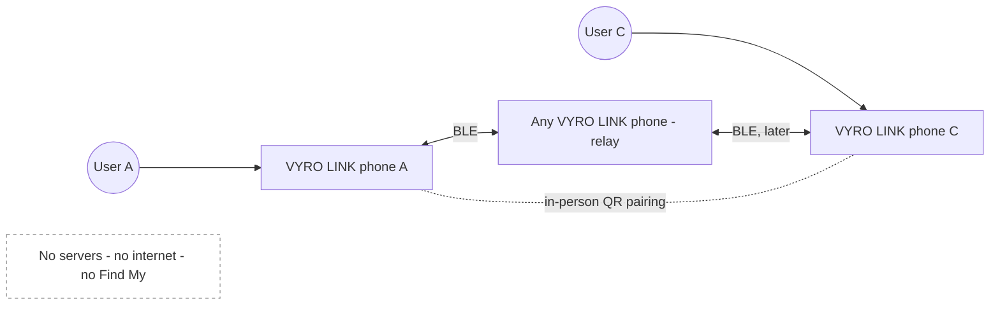

### 10.2 Component architecture

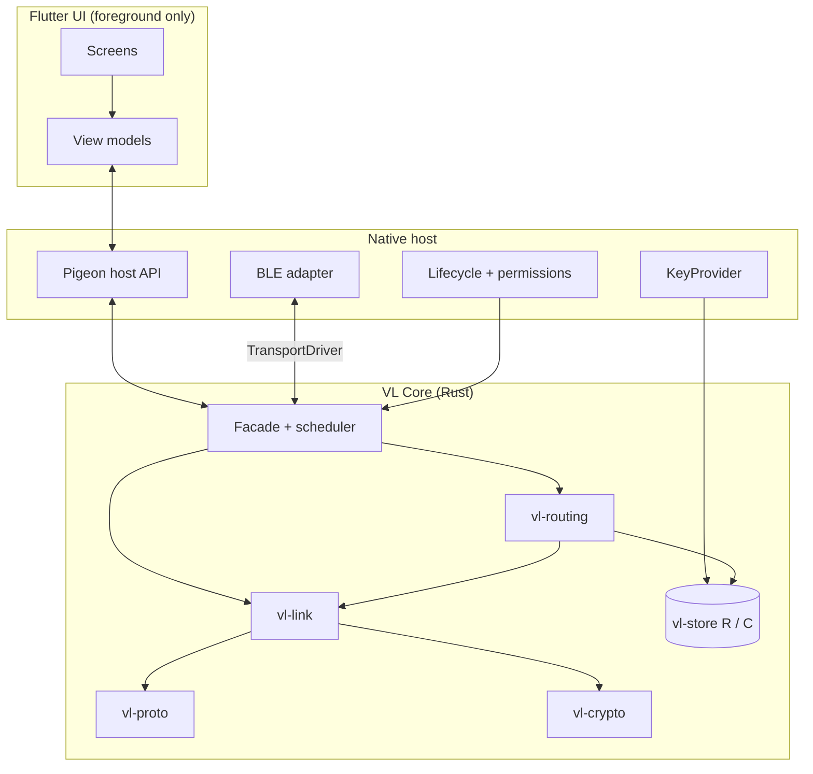

### 10.3 Cross-platform architecture

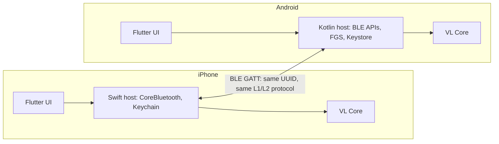

### 10.4 Wireless transport selection

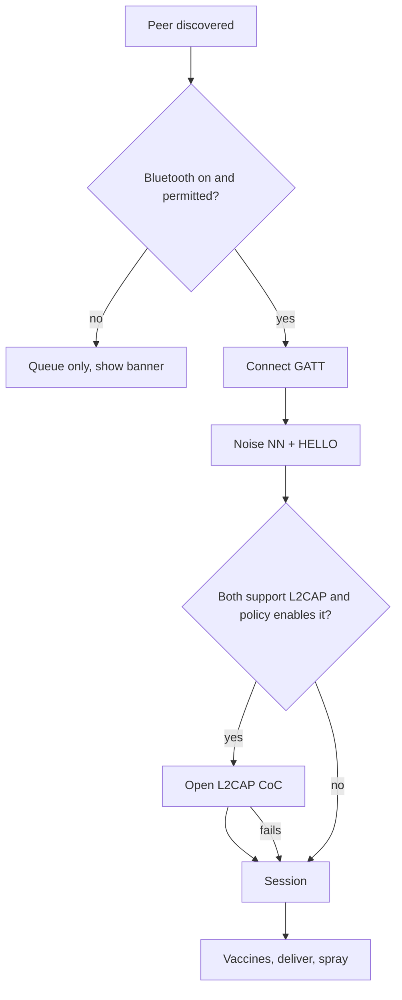

### 10.5 Contact pairing

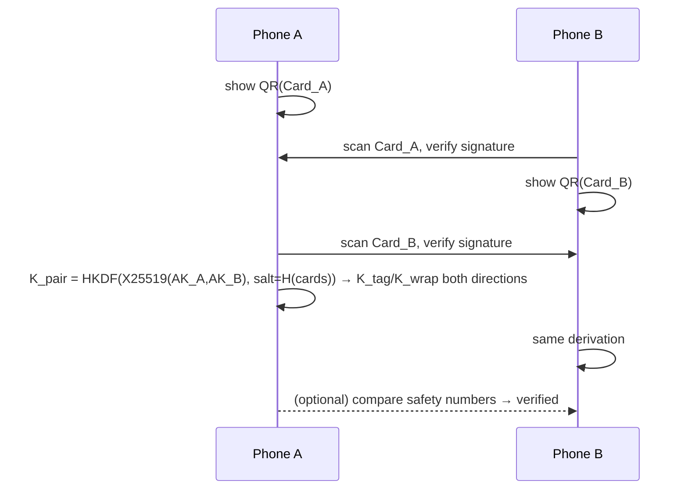

### 10.6 Encrypted message exchange

```mermaid
sequenceDiagram
  participant A as Sender core
  participant L as Neighbour link (Noise NN)
  participant C as Recipient core
  A->>A: Olm encrypt → inner{type,message_id,ack_secret,olm}
  A->>A: ChaCha20-Poly1305(K_wrap A→C, nonce96, AAD=header)
  A->>L: ENVELOPE (header ‖ body) inside Noise transport
  L->>C: (possibly after many hops)
  C->>C: tag → contact; unwrap (Class R key) → DELIVERED (recipient-side)
  C->>C: on unlock: Olm decrypt → DECRYPTED
```

### 10.7 Multi-hop forwarding

```mermaid
sequenceDiagram
  participant A
  participant B
  participant D
  participant C
  A->>B: budget 4 → B gets 2 (A keeps 2)
  A->>D: later: D gets 1 (A keeps 1)
  B->>C: B meets C: C REQUESTs (tag match) → deliver; B keeps copy
  C-->>B: VACCINE → B purges
  B-->>D: later meeting: VACCINE → D purges
  C->>B: RECEIPT envelope (routed like data)
  B->>A: receipt delivered → A: ACKNOWLEDGED
```

### 10.8 Store-and-forward persistence

```mermaid
sequenceDiagram
  participant OS
  participant N as Native host
  participant K as VL Core
  participant DB as Class R db
  OS->>N: wake (BLE event / restoration / FGS)
  N->>K: init (if needed) + set_app_state(Locked)
  K->>DB: open with R key (after first unlock)
  K->>K: run_maintenance(now)
  N->>K: link_opened / frame_received …
  K->>DB: persist custody/carry/outbox changes per frame (transactional)
  OS-->>N: suspend / terminate
  Note over DB: state survives; next wake resumes
```

### 10.9 Delivery acknowledgement

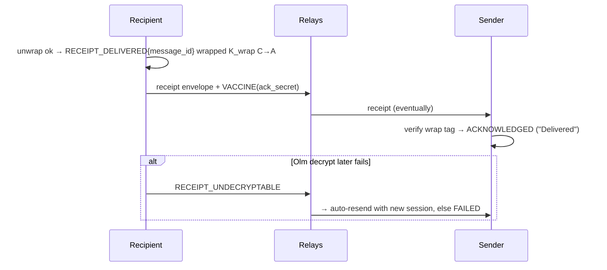

### 10.10 Application lifecycle behaviour

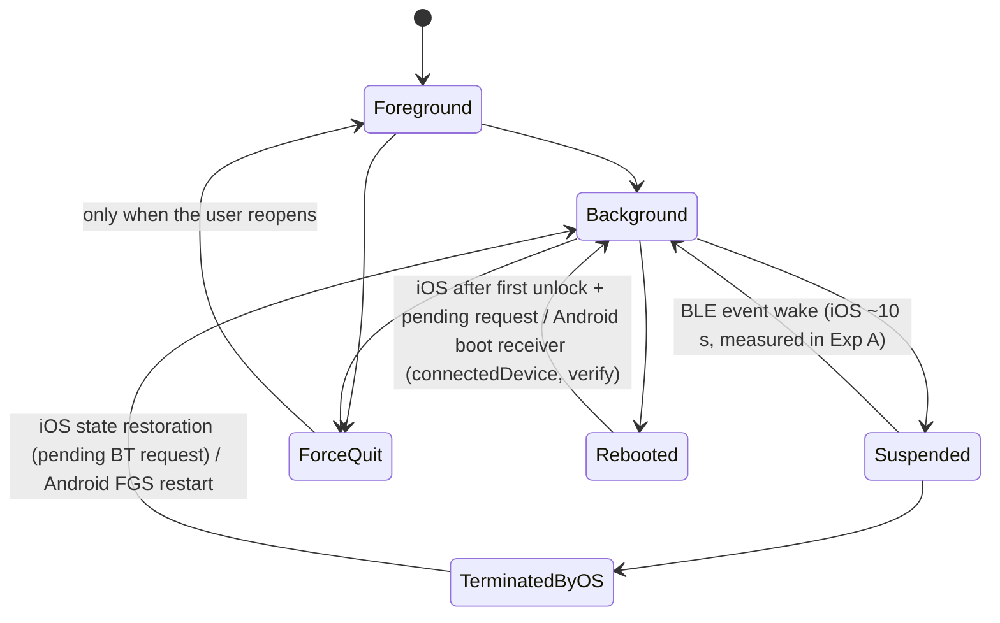

### 10.11 Security trust boundaries

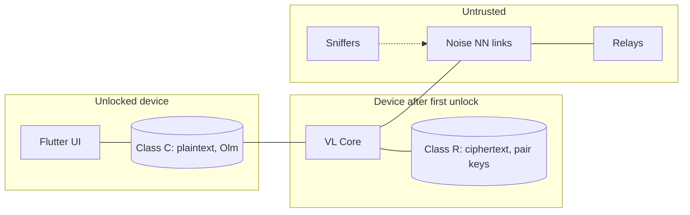

### 10.12 Error recovery

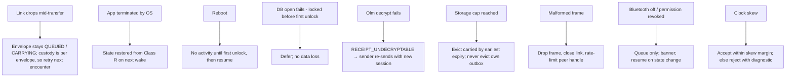

---

## 11. UI/UX

**Normative:** Doc 16, which covers 14 screens, tokens with computed contrast, navigation, states and accessibility.

**Hard rules carried into implementation:**
- "Delivered" only for `ACKNOWLEDGED`;
- no nearby-people lists;
- no internet error states;
- permission education before system prompts.

## 12. Dependency specification (evaluate/install only when development is authorised)

### 12.1 Required for the MVP

| Layer | Dependency | Version / licence | Evidence & notes |
|---|---|---|---|
| Rust | vodozemac | 0.11.x · Apache-2.0 · MSRV 1.96 | Audit 2022; advisories fixed. Use Olm only |
| Rust | x25519-dalek / curve25519-dalek | 3.x / 5.x · BSD-3 | Quarkslab 2019; ensure ≥ fixed versions |
| Rust | chacha20poly1305, hkdf, hmac, sha2, zeroize, getrandom | RustCrypto · Apache-2.0 OR MIT | NCC 2020 (AEAD) |
| Rust | snow | 0.10.x · Apache-2.0 OR MIT | No audit; review the integration at P9 |
| Rust | rusqlite (`bundled-sqlcipher-vendored-openssl`) → SQLCipher 4.x + OpenSSL | MIT / BSD-3 / Apache-2.0 | Feature verified in Cargo.toml [S82] |
| Rust | uniffi | 0.32.x · **MPL-2.0** (file-level copyleft: modifications to UniFFI files must be shared; linking is fine) | Mozilla production use [S80] |
| Rust | qrcode (QR matrix generation) | Apache-2.0 (repo) | Replaces the stale qr_flutter (last push 2024-06) |
| iOS | CoreBluetooth, Security (Keychain), UIKit lifecycle | Apple SDK (Xcode 27) | — |
| Android | android.bluetooth / le, Keystore, foreground service, AndroidX core | Android SDK 37 | Use the new `connectGatt(BluetoothGattConnectionSettings, …)` on API 37+ [S68] |
| Flutter | Flutter SDK (stable at Phase 6 start); pigeon | BSD-3 | Pin at Phase 1 |
| Flutter | mobile_scanner | BSD-3 | QR scanning (foreground only) |
| Tooling | rustup (stable ≥ 1.96), cargo-ndk, Android NDK, Android Studio, Xcode 27, cargo-audit, cargo-deny, OSV-Scanner, cargo-fuzz | — | Phase 1 |

### 12.2 Optional (later)

- Google Nearby Connections (Apache-2.0): secondary transport.
- Native Wi-Fi Aware: contacts only.
- flutter_riverpod (MIT): only if built-in state management proves insufficient.
- flutter_rust_bridge (MIT): alternative binding if Pigeon + native becomes awkward.
- Research tools (Doc 13): Wireshark, PacketLogger, nRF Connect, nRF Sniffer.

### 12.3 Rejected

| Dependency | Reason |
|---|---|
| flutter_blue_plus | Commercial licence for for-profit use; central role only; Dart-side background [S47] |
| bluetooth_low_energy / other Flutter BLE plugins | BLE is native by design (ADR-013); slower maintenance (R-15) |
| libsignal | AGPL-3.0 [S46] |
| famedly/dart-vodozemac | AGPL-3.0 wrapper; crypto belongs in the Rust core |
| Dart `cryptography`, `sodium` bindings | Crypto is not in Dart |
| drift, sqflite_sqlcipher, flutter_secure_storage | DB and keys are owned by the core + native KeyProvider |
| qr_flutter | Stale; replaced by the Rust `qrcode` crate + a custom painter |
| Bridgefy SDK | Proprietary; broken security history [S28–S30] |
| Briar / Meshtastic / bitchat-android / OpenHaystack code | GPL/AGPL; study only |
| protobuf / CBOR / BPv7 libraries | Fixed binary header by design (ADR-006/017) |

**bitchat iOS** (Unlicense): **reference only**. Patterns may inform the Swift BLE adapter; any copied code must be reviewed like new code.

## 13. Testing

**Normative:** Doc 17. It covers unit/protocol/crypto/DB/integration tests (automated) separately from physical-device experiments (Doc 14 A–C, Doc 08 E-series).

## 14. Error handling

| Class | Policy |
|---|---|
| Radio input errors | Drop the frame, close the link, increment a diagnostic counter, short backoff for that peer handle. Never panic |
| Crypto failures | Treat as hostile: no partial plaintext ever surfaces; receipt-level feedback only via authenticated types |
| Storage errors | Fail closed (stop relaying) and surface to Diagnostics; never drop own outbox silently |
| Lifecycle | Every entry point is idempotent; maintenance can run at any time |
| User-visible | Plain language (Doc 16 §9); errors never auto-dismiss |
| Diagnostics export | Counters, version info and sanitised error codes only. **No tags, IDs, keys, names or message content** |

## 15. Performance requirements

| Requirement | Target | Status |
|---|---|---|
| Link session (connect → HELLO → SUMMARY → 1 envelope) | ≤ measured median iOS wake on the target device (P90) | **Pending Exp A** |
| Core processing per envelope (parse + wrap verify + DB write) | Small fraction of the session budget; measure in Phase 4 benchmarks | **Pending** |
| Battery (relay modes) | ≤ user-elicited threshold (Doc 14 §8.2) | **Pending Exp C** |
| UI | Platform frame budget (no dropped frames in scrolling lists on reference devices) | Measure in Phase 6 |
| Storage | Carry cap enforced exactly; DB size bounded by caps + expiry | Testable (T-DB) |
| Delivery latency / ratio | **No target until E9 simulation + Exp B + pilot** | Pending |

## 16. Release criteria

All of the following must hold before any public release:
1. Gates GA, GB, GS, GC passed (Doc 14 §11).
2. Doc 17 automated suites green; fuzzing campaign with no open crashes.
3. Physical-device matrix (Doc 17 §4) passed.
4. Independent security review with no open high/critical findings (G4).
5. Play policy acceptance of FGS relay mode, or the documented fallback.
6. In-product limitation disclosures (Doc 06 §10).
7. E12 pilot meets the product requirement set after the baselines (Doc 09 §5).
8. Licence compliance review.

## 17. Known limitations and deferred features

### 17.1 Known limitations

- Best-effort delivery with unbounded latency.
- iPhones are not dependable relays (force-quit, reboot before unlock, OS throttling).
- A background iPhone is undiscoverable by Android.
- The presence of VYRO LINK devices is observable.
- Lost-device revocation is impossible.
- No recall of handed-off copies.
- No post-quantum protection.
- Text only.

### 17.2 Deferred features

| Feature | Reason |
|---|---|
| Group messaging | MLS/DTN conflict (Doc 06 §11) |
| Media/files/voice | Throughput and abuse; needs Wi-Fi Aware/P2P between contacts |
| Read receipts on by default | Privacy |
| Best-effort unsend (early vaccine) | Not needed for the MVP |
| Multi-device per user | Complexity |
| Internet-assisted sync | Infrastructure and metadata (ADR-012) |
| Wi-Fi Aware / Apple P2P / Nearby adapters | Deferred transports |
| Encounter-history routing (PRoPHET-class) | Privacy design needed |
| Location sharing | Unsafe |
| Public/broadcast channels | Unsafe |

## 18. Outstanding feasibility questions (all **pending**, none tested)

| Question | Experiment | Consequence if negative |
|---|---|---|
| Background/locked iPhone ↔ Android FGS sessions viable? | A2, A3, A-L | iPhone endpoint-only or Architecture D (Doc 14 §12) |
| Session fits the iOS wake? | A2–A4 (HA2) | Resumable sessions / endpoint-only |
| State restoration rejoins after termination? | A4 | Rely on foreground re-entry |
| Multi-hop delivery + receipts + persistence + dedup on devices | B1–B6 | Routing/persistence redesign |
| E2E through untrusted relays (canary, tamper, replay, forged receipt) | B5 | Security fix before continuing |
| Battery acceptable? | C + survey | Charging-only relay; endpoint-only; D |
| Recovery after disconnection, termination, reboot | A4, A6, B2 | Lifecycle redesign |
| Delivery ratio at realistic density | E9 (simulation), E12 (pilot) | Product repositioning |
| Play policy for relay FGS | Internal-track submission (Phase 2/7) | Fallback relay modes |

---

## 19. Implementation roadmap

| Phase | Prerequisites | Deliverables | Depends on | Acceptance criteria | Risks |
|---|---|---|---|---|---|
| **1. Environment preparation & project initialisation** | User approves installs (C1); licence decision (C4) | Toolchains (rustup ≥ 1.96, cargo-ndk, NDK, Android Studio, Flutter SDK pinned, pigeon); **monorepo** (`core/` Rust workspace, `ios/` host, `android/` host, `app/` Flutter, `tools/`, `docs/` → this research); CI (build + test + cargo-audit/deny + OSV); UniFFI "hello" bound into a minimal Swift and Kotlin host; confirm UniFFI async foreign-trait support | — | Core builds for iOS, Android and macOS; CI green; bindings callable from both hosts | Toolchain friction; UniFFI async (R-30) |
| **2a. Native transport feasibility prototype** | Phase 1; ≥ 1 Android phone (C2) | VL Probe hosts (Doc 14 §5.2 P-1, P-2, P-7, P-8, P-10) using a plaintext test-link variant; **Experiments A and C executed**; results tables filled with raw data | 1 | Doc 14 gate **GA** and **GC** evaluated with real data | Only one iPhone (R-28) |
| **3. Identity, encryption, secure pairing** (core) | Phase 1 | `vl-crypto`: Olm via vodozemac, pairing cards, HKDF derivations, safety numbers, wrap AEAD, tags, Noise NN via snow; **cross-platform test vectors** | 1 (parallel with 2a) | T-CRY suite green; vectors pass on macOS, iOS and Android builds | Library integration subtleties (OTK/fallback) |
| **4. Local persistence + message protocol** (core) | Phase 1 | `vl-store` (R/C DBs, schema §9, migrations, GC), `vl-proto` (L1/L2/L3 codecs), parser fuzzing, `vl-link` session state machine | 1 (parallel with 2a, 3) | T-DB, T-PRO suites + 24 h fuzz without crash | SQLCipher build per platform |
| **5. Store-and-forward routing** (core + simulator) | 3, 4 | `vl-routing` (§7.3), receipts/vaccines, quotas; `vl-sim` discrete-event simulator; **E9 parameter study** | 3, 4 | T-RTE suite green; E9 report with recommended parameters | Unrealistic mobility models |
| **2b. Multi-hop device experiment** | 2a passed GA (at least "architecture change" accepted); 3–5 complete | Probe hosts embedding the real core; **Experiment B (B1–B6)** | 2a, 3–5 | Gate **GB** and **GS** | Encounter choreography |
| **6. Shared mobile UI** | **GA + GB + GS passed** | Flutter UI per Doc 16 with Pigeon API; all 14 screens, states, accessibility | 5, 2b | T-UI suites; accessibility audit | Scope creep |
| **7. Native iOS & Android integration** | 6 | Production native hosts (BLE adapters, lifecycle, KeyProvider, permissions, FGS, boot restart), Play FGS declaration + internal-track review | 2a code knowledge, 6 | Full app runs on the device matrix; Play feedback received | Play policy (R-07), OEM kills (R-08) |
| **8. Multi-device integration testing** | 7 | Doc 17 §4 matrix; Exp A–C re-run on the production app; E10/E11 privacy and abuse tests; small pilot (E12 start) | 7 | All physical-device acceptance criteria met | Device availability |
| **9. Security review & performance optimisation** | 8 (code freeze) | External audit (§8.5 list), fixes, performance tuning against the measured budgets | 8 | No open high/critical findings (G4) | Audit findings requiring redesign |
| **10. Release preparation** | 9 | Store listings, privacy policy, disclosures, licence compliance, pilot results | 9 | §16 release criteria all met | Store review |

**Parallelism:**
- Phases **2a, 3 and 4 run in parallel** after Phase 1.
- Phase 5 follows 3 and 4.
- **2b waits** for 2a and 3–5.
- **Phases 6–10 wait for gates GA, GB and GS.**
- GC must pass (or an accepted mitigation) before Phase 7 completes.

## 20. Decisions that require user input

| # | Decision | Default proposed here |
|---|---|---|
| U-1 | Product licence (open source vs proprietary) | Undecided. All required dependencies are compatible with either (MPL-2.0 UniFFI is file-level) |
| U-2 | Approve tool installation (Phase 1) | Required |
| U-3 | Buy/obtain Android phone(s), a second iPhone, shielding pouches | ≥ 1 Android 16/17 (blocking) |
| U-4 | Apple Developer Program membership (TestFlight, provisioning) | Recommended |
| U-5 | Minimum OS versions | iOS 17, Android 12 (API 31) |
| U-6 | Pre-register gate rules (Doc 14 §11) | As written |
| U-7 | Build VYRO LINK vs contribute to bitchat (Doc 09 §6.2) | Build (contacts-only trust model differs) |
| U-8 | Distribution of Android relay mode if Play rejects the FGS | Fallback modes; consider alternative stores |
| U-9 | Brand identity (name usage, logo, accent colour) | Doc 16 tokens as placeholder |
| U-10 | Pilot group for E12 and the battery acceptability survey | — |

---

## 21. Final decision and handoff

| # | Question | Answer |
|---|---|---|
| 1 | Final recommended architecture? | **Flutter UI + native Swift/Kotlin hosts + shared Rust core** (UniFFI), BLE dual-role transport, store-and-forward spray-and-wait routing, Olm-in-wrap E2E, two-class encrypted storage (§5) |
| 2 | Primary wireless transport? | **BLE GATT** (L2CAP CoC an optional measured upgrade) |
| 3 | How will iOS and Android communicate? | One fixed service UUID, the same L1/L2 protocol over GATT. Foreground: either side connects. **Backgrounded iPhones initiate to Android relays**; Android never blind-connects to Apple devices |
| 4 | How will messages travel across relays? | Binary spray-and-wait (L = 4, cap 8), direct delivery by tag request, expiry 72 h, hop limit 8, vaccines, one sender retry (§7.3) |
| 5 | How will messages stay encrypted through relays? | Olm (vodozemac) inside a pairwise ChaCha20-Poly1305 wrap; Noise NN on every link; relays see only the 62-byte header |
| 6 | How are recipients and acknowledgements authenticated? | Recipients: Olm authentication from QR-paired identities. Acknowledgements: `RECEIPT_DELIVERED` authenticated by `K_wrap(recipient→sender)`. **Only a verified receipt yields "Delivered"** (ADR-015) |
| 7 | Most important platform limitations? | iOS: force-quit/BT-off/pre-unlock = no participation; ~10 s wakes; background adverts unreadable by Android. Android: FGS needed for relaying; OEM kills; Play review |
| 8 | Which dependencies? | §12.1 (vodozemac, dalek, RustCrypto, snow, rusqlite+SQLCipher, UniFFI, qrcode; Flutter + pigeon + mobile_scanner; native SDKs) |
| 9 | MVP features? | §1 MVP scope / FR-01…FR-15 |
| 10 | Deferred features? | §17.2 |
| 11 | Untested feasibility experiments? | **All of them:** Doc 14 A, B, C; Doc 08 E4, E6, E9–E12, E16, E17 |
| 12 | Largest remaining risk? | Whether backgrounded, locked iPhones participate enough (with Android relays) for useful multi-hop delivery (R-01/R-02), followed by real-world density (R-04) |
| 13 | Before public release? | §16: all gates incl. the independent security review, the device matrix, Play acceptance, disclosures, pilot results |
| 14 | Ready for implementation planning? | **Yes.** The architecture is frozen for the MVP. **Ready to start development of Phases 1, 2a, 3, 4, 5 (then 2b)**; **not** ready to build the full application (6–10) |
| 15 | Exact next action? | Obtain the user approvals C1–C4 and run the development prompt in §22 |

### Final status: **CONDITIONAL GO**

- **Authorised now:** a limited prototype and core development (Phases 1, 2a, 3, 4, 5; 2b when ready).
- **Not authorised:** the complete application (Phases 6–10) until gates GA, GB and GS pass with real measurements and GC passes or has an accepted mitigation.

**Mandatory conditions:**
- **C1:** the user approves installing development tools.
- **C2:** ≥ 1 Android 16/17 phone is available (blocking for 2a).
- **C3:** gate rules pre-registered.
- **C4:** product licence chosen before repository initialisation.
- **C5:** no Phase 6+ work before gates.
- **C6:** no claims of delivery reliability or security assurance before the gates and G4.

## 22. Next development prompt (use verbatim)

```
VYRO LINK — DEVELOPMENT START (Phases 1, 2a, 3, 4, 5 only)

Context: The research package in VyroLink/research/ is complete. Doc 18 (18-development-blueprint.md) is authoritative; Doc 14 defines the feasibility experiments and gates; Doc 17 defines tests; Doc 16 defines UI (not to be built yet). Status: CONDITIONAL GO.

Approvals given by me: [C1 install tools: YES/NO] [C2 Android device available: model/OS] [C4 licence: ___] [C3 gate rules accepted as written: YES/NO]

Do, in order, stopping for my confirmation before any installation command:
1. Phase 1: list every tool/version you will install (Doc 18 §12, §19), wait for my approval, install, then initialise the monorepo in VyroLink/ (core/ Rust workspace with crates vl-proto, vl-crypto, vl-store, vl-link, vl-routing, vl-core, vl-sim, vl-vectors; ios/ Swift host; android/ Kotlin host; app/ Flutter placeholder only; tools/; LICENSE per my choice; CI with build, tests, cargo-audit, cargo-deny). Prove UniFFI bindings work from minimal Swift and Kotlin hosts and confirm async foreign-trait support.
2. Phases 3–5 (Rust core, desktop-first, test-driven per Doc 17): implement exactly the protocol, crypto suite, data model, routing and delivery-state model of Doc 18 §7–§9, with cross-platform test vectors and parser fuzzing. No deviations from frozen decisions without writing an ADR and asking me.
3. Phase 2a in parallel: build the throwaway VL Probe native hosts (Doc 14 §5.2) for Experiments A and C, and give me the step-by-step device procedure; record raw results into Doc 14 §10 tables only from real measurements.
Constraints: do not build the Flutter UI or production native apps (Phases 6–10) until gates GA, GB, GS are evaluated with real data; never mark an experiment passed without raw evidence; no network permission in any build; follow existing skills (now in ~/.claude/skills) where relevant.
```

---

## Addendum A — Development-phase decisions (2026-10-15)

These ADRs came out of implementation and simulation. **Status: APPROVED by the user on 2026-10-15** (§22 requires approval for deviations from frozen decisions). Each one can still be reverted in one place. The evidence is in Doc 20 §4 and Doc 22.

| ADR | Decision | Changes | Revert point |
|---|---|---|---|
| ADR-020 | A vaccine secret matching `ack_commitment` is delivery proof (equivalent to a verified `RECEIPT_DELIVERED`) | §7 delivery evidence (adds a second proof; ADR-015 still holds: custody is never proof) | `vl-core` `apply_events` (`OwnDelivered`) |
| ADR-021 | Default copy budget **L = 8** (cap stays 8) | §7 table row "Copy budget L / cap" 4 / 8 → **8 / 8** | `vl-routing` `Policy::default_spray()` |
| ADR-022 | Pull-based FFI byte API (`link_receive(bytes) → bytes`); no foreign callbacks, no async foreign traits | §6 API shape; resolves R-30 by avoiding it | `vl-ffi` |

**Crate layout as built:**
- §22 listed `vl-link` and `vl-vectors`. As built, Noise links live in `vl-crypto::link` and link sessions in `vl-core::link`. Vectors are a data file (`core/vectors/proto-v1.txt`) tested from `vl-proto`.
- `vl-ffi` and `uniffi-bindgen` were added.
- The `ios/`, `android/` and `app/` hosts are not created yet (Phase 5 is blocked; see Doc 20 §6).

**Wire format:** Doc 21 is normative for the bytes as implemented.

## Addendum B — Conversation features (2026-10-15)

| ADR | Decision | Evidence | Status |
|---|---|---|---|
| **ADR-023** | Conversation features are **authenticated content events** that reference a target message ID. They are carried in a new inner kind `0x11 CONTENT` inside the existing Olm + wrap layers, and merged with **order-independent rules**. The rules: latest-wins reactions; sender-only edits (≤ 10, 24 h); sender-only delete requests (72 h) with tombstones for early arrival; last-writer-wins disappearing timer. No new cryptography, and no change to any existing wire byte; TEXT `0x10` is still decoded. | Delta Chat tombstones and sender checks, SimpleX `XMsg*` events, Matrix replacement/redaction events, Meshtastic `reply_id`, Briar auto-delete (`research/messaging-apps/02`, `05`). Tests: `vl-store/tests/features.rs`, `vl-core/tests/features.rs`, vectors `content_*` | **APPROVED by the user on 2026-10-15**; implemented and frozen |
| ADR-024 | Group messaging (when built) uses **pairwise fan-out** over existing Olm sessions. MLS is rejected for offline use: commit ordering needs a delivery service, and out-of-order commits fork. Megolm with a group tag is deferred until a reviewed group-addressing design exists. | RFC 9420 DS assumption; DMLS and decentralised-MLS drafts; bitchat group design | **APPROVED by the user on 2026-10-15**; not yet implemented (F-13) |

**Specifications:** the normative bytes and merge rules are in Doc 21 §4.1. Feature tiers, acceptance criteria and status are in `research/messaging-apps/06`, `08` and `09`.

## Addendum C — Algorithm phase (2026-10-15)

| ADR | Decision | Evidence | Status |
|---|---|---|---|
| **ADR-025** | The inner `sent_at_ms` is a **hybrid logical clock**: `max(physical, last + 1)` on send; it absorbs received values up to 1 h ahead. All LWW merges use it. | A clock-skew causality bug was reproduced by a failing test and fixed (`research/algorithms/04` §3). No wire-format change | **Accepted as a correctness fix; listed for your review** |

## Addendum D — App features (2026-10-16)

| ADR | Decision | Evidence | Status |
|---|---|---|---|
| **ADR-026** | **Attachments.** Images (JPEG re-encoded on the phone, ≤ 16 KiB) and files (≤ 64 KiB). An Olm `ATTACHMENT` content event (ctype 0x09) announces the attachment: id, kind, size, SHA-256 of the whole file, a **one-time 32-byte key**, name and caption. The bytes travel as ≤ 47 **`ATTACHMENT_CHUNK` inner messages (kind 0x12)**, each sealed with ChaCha20-Poly1305 under that key. The nonce is the chunk index; the AAD is `"VL/att/v1" ‖ attachment_id ‖ index`. The chunks travel inside the normal pairwise wrap, with copy budget 2, their own receipts and vaccines. The receiver completes the attachment only when every chunk opens and the SHA-256 matches. There are per-contact partial quotas (256 KiB) and an orphan TTL | The first design sent each chunk as an Olm message (algorithms/10). A test lost the announcement in about 1 run in 3: vodozemac keeps only **40 skipped message keys** (`MAX_MESSAGE_KEYS`), so 48 Olm messages arriving in random order can exhaust it. Moving chunks out of Olm fixed it (12/12 repeated runs). The pattern matches Signal/Matrix attachments; there are no new primitives (ChaCha20-Poly1305 is ADR-014's AEAD). Tests: `vl-core/tests/extras.rs` (direct, via a relay over several rounds, deletion), store quota/order/tamper tests, crypto key/index/tamper tests, vectors, fuzz (decode_all 44.8 M runs, 0 crashes) | **Approved by you on 2026-10-16** (attachments); the chunk-encryption detail is **listed for your review** |
| ADR-027 | **ID code:** `Crockford-Base32(Trunc20(SHA-256("VL/id/v1" ‖ Ed25519 identity key)))`, 32 characters (digits and letters without I L O U). Display and comparison only; never sent, never used as a key. Unique without any registry (160 bits) | Requested; Google sign-in was rejected by you in favour of this (no account, no internet). Test `id_code_is_32_unambiguous_characters_and_differs_per_key` with a golden value cross-checked in Python | **Approved by you on 2026-10-16** |
| ADR-028 | **Re-pairing:** scanning an existing contact's code in person (same identity key, signed card) replaces their card, pairwise keys, tags and one-time keys, and drops old Olm sessions. History and verification are kept. It replaces the `AlreadyPaired` error and is the "key refresh" of FR-15. Identity rotation/revocation stays out (it would need a reviewed design) | Test `re_pairing_in_person_refreshes_keys_and_keeps_history`; `pairing_errors` updated | **Approved by you on 2026-10-16** ("key refresh") |

Implementation-level changes that need no ADR (no wire or semantics change) are recorded in `research/algorithms/09`:
- indexed vaccine lookup;
- delta refresh (policy flag `delta_refresh`, default on);
- late authenticated proof upgrading `Expired`/`DeliveryUnknown`.

